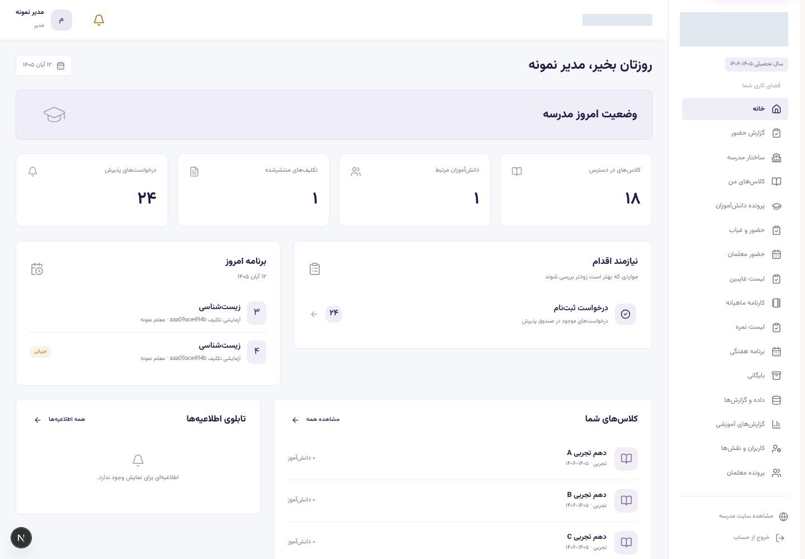
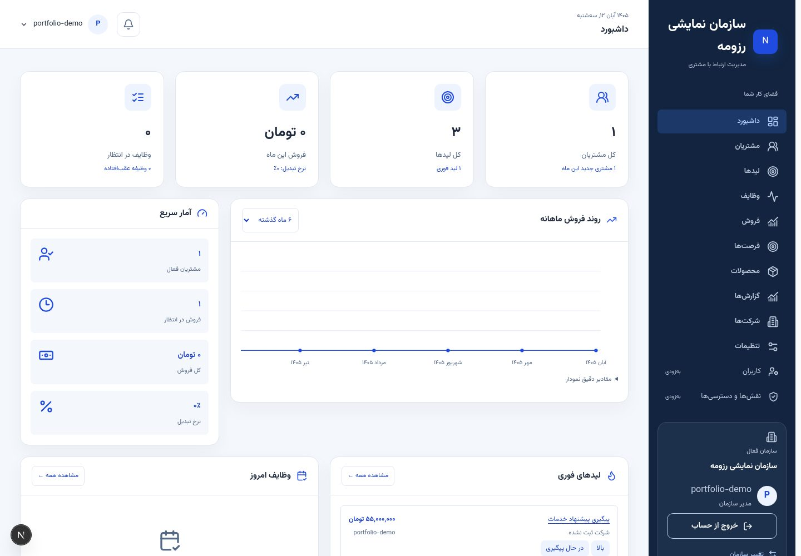

# Amir Sarhadi

### Full-Stack Developer · Django / React / Next.js · Applied AI

I build business web applications with **7+ years of software development experience**. My work spans accounting and inventory systems, CRM, school operations and marketplaces, from data models and REST APIs to responsive interfaces and operational workflows.

I focus on clear domain boundaries, explicit validation and maintainable frontend/backend integration. My AI-related work includes OCR/computer-vision research and a human-reviewed floor-plan prototype.

**30+ projects developed · 10+ active projects and websites · Open to remote opportunities worldwide**

[amirsarrhadii@gmail.com](mailto:amirsarrhadii@gmail.com) · **[Resume — PDF](resume/Amir-Sarhadi-Resume.pdf)** · [Editable Word](resume/Amir-Sarhadi-Resume.docx) · [Text version](RESUME.md) · [GitHub](https://github.com/AmirrSarhadi)

## Technical Skills

| Area | Technologies & practice |
| --- | --- |
| **Backend** | Python, Django, Django REST Framework, REST APIs, relational modeling, service-layer design, Oracle APEX |
| **Frontend** | JavaScript, TypeScript, React, Next.js, form validation, typed API clients, responsive UI |
| **Data & delivery** | PostgreSQL, Redis, Git, Docker, GitHub Actions |
| **Quality & workflows** | Backend tests, Playwright, transactions, version-aware updates, reporting, import/review flows |
| **Localization** | Persian RTL interfaces, Jalali calendars, exact money and inventory-unit inputs |
| **Applied AI** | OpenCV, PaddleOCR, YOLO-based experiments, screenshot analysis, human-reviewed AI workflows |

## Work Experience

| Role & organization | Work | Dates |
| --- | --- | --- |
| **Programmer — Nexio Smart-Home Representative, Kerman** | IoT and smart-home software development/programming. | 2025–2026 · Mehr 1404–Esfand 1404 |
| **Full-Stack Web Developer — Paydar Tech, Kerman** | Website and web application development with Django, React and Next.js. | 2025 · Bahman 1403–Mehr 1404 |
| **Programmer & Web Developer — Shahid Bahonar Copper Industries, Kerman** | Oracle APEX web application development. | 2023–2025 · Khordad 1402–Esfand 1403 |

Dates preserve the supplied Solar Hijri months; Gregorian years are shown for reference.

## Selected Project Experience

| Project | Engineering work | Evidence |
| --- | --- | --- |
| **Local Accounting / ERP** | Accounting, treasury, catalog and inventory workflows; document lifecycles, reversal patterns and operational reports. | [Case study](projects/accounting-erp.md) · [Code & screens](showcase/local-accounting/COVERAGE.md) |
| **School LMS** | Attendance, assignments, online exams, grading/correction workflows and school reporting with role-aware interfaces. | [Case study](projects/school-lms.md) · [Code & screens](showcase/lms-real/COVERAGE.md) |
| **NewCRM** | Organization-scoped customer records, leads, opportunities, activities and sales dashboards with typed client workflows. | [Case study](projects/newcrm.md) · [Code & screens](showcase/newcrm-real/COVERAGE.md) |
| **Kerman Cars** | Automotive marketplace with buyer discovery, vehicle forms, seller/dealer workspaces and moderation/management screens. | [Case study](projects/kerman-cars.md) · [Code & screens](showcase/kerman-cars/COVERAGE.md) |
| **Cafe Accounting** | Menu, order entry, customer records and inventory screens, with reusable forms and exact inventory-unit conversions. | [Case study](projects/cafe-accounting.md) · [Code & screens](showcase/cafe-accounting/COVERAGE.md) |

<table>
<tr>
<td width="50%" valign="top">

<b>School operations</b> — actual interface, demonstration data.
</td>
<td width="50%" valign="top">

<b>Sales workspace</b> — actual interface, demonstration data.
</td>
</tr>
</table>

**Additional work:** [ContentFlow — frontend & workflow engineering](projects/contentflow.md) · [Laitco — website development & delivery](projects/laitco.md) · [Earlier CRM / sales-operations platform](projects/crm-lead-management.md).

## Engineering Examples

- **Financial consistency:** [document lifecycle](showcase/erp-accounting-real/snippets/document-lifecycle.md), [treasury reversal](showcase/erp-accounting-real/snippets/treasury-reversal.md) and [invariant-test excerpts](showcase/erp-accounting-real/snippets/financial-invariants-tests.md).
- **Controlled updates:** [exam lifecycle and grading workflows](showcase/lms-real/README.md), with version-aware edits and explicit review/publication states.
- **Localized precision:** [exact money and Persian-date parsing](showcase/newcrm-real/source/frontend/lib/sales-entry.ts), including a [reviewable boundary test](showcase/newcrm-real/source/frontend/tests/sales-entry.cjs).

[Browse all project code and interface galleries →](showcase/COVERAGE.md)

Public code selections omit sensitive implementation and configuration. Screenshots use demonstration data or explicitly identified API fixtures; they are not live customer records or measured business results. [Scope and verification](showcase/VERIFICATION.md).

## Research & Prototypes

- **[Automatic UI Evaluation](projects/automatic-ui-evaluation.md):** OCR and computer-vision research for extracting interface structure and evaluating measurable layout characteristics using Python, OpenCV and PaddleOCR.
- **[Smart Home AI](projects/smart-home-ai.md):** an early-stage floor-plan review interface with human correction and preliminary-suggestion presentation. [Code and workflow gallery](showcase/smart-home-ai/COVERAGE.md).
- Related case studies: [vision-assisted UV disinfection robot](projects/uv-disinfection-robot.md) · [disease prediction & chatbot](projects/disease-prediction-chatbot.md).

## Education

**M.Sc. in Artificial Intelligence — in progress** — Shahid Bahonar University of Kerman.

**B.Sc. in Computer Engineering** — Shahid Bahonar University of Kerman.

## Opportunities & Links

Open to **remote opportunities worldwide** in full-stack development, applied AI and related software engineering. My focus is custom business applications, rapid prototyping and iterative product development.

[Email](mailto:amirsarrhadii@gmail.com) · [GitHub profile](https://github.com/AmirrSarhadi) · [Resume PDF](resume/Amir-Sarhadi-Resume.pdf) · [Development services](services.md) · [Laitco project website](https://laitco.ir) · [Certificates](certificates/README.md)
