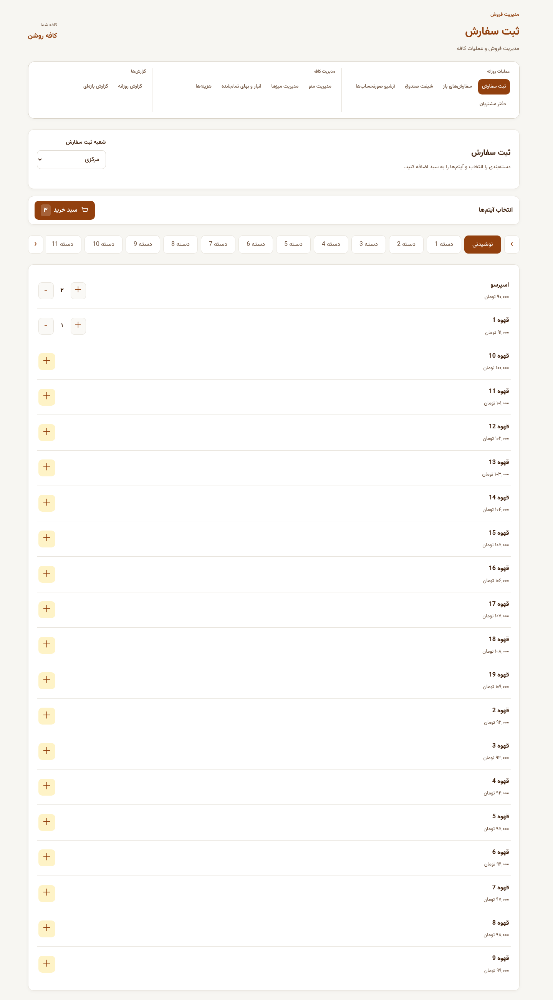
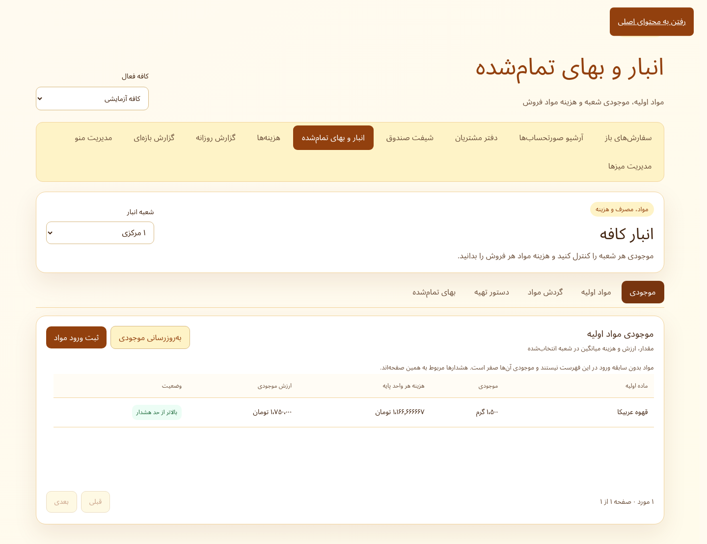

# Cafe Accounting — Orders, Inventory & Operations

A Persian cafe operations application spanning menu/catalog workflows, order entry, open orders, settlement, cash shifts, customer records, inventory and reporting. The expanded selection focuses on shared UI and inventory screens while keeping settlement, costing internals and tenancy enforcement private.

**Stack:** React 19 · TypeScript · Vite 7 · Django backend

[← Profile](../../README.md) · [All project showcases](../README.md)

## Expanded source

This collection contains **30 complete source files**, copied without code changes. It is a reading-oriented source selection, not a standalone runnable application. Imports into omitted modules are intentionally retained.

- Inventory, ingredient catalog, movement forms, recipes and cost-report presentation.
- Shared modal, form, navigation and resource-loading components.
- Exact unit-conversion helpers with their existing unit tests.
- Order-entry and table-management components where included in the source index.

### Start reading

- [Inventory workspace](source/frontend/src/inventory/InventoryWorkspace.tsx)
- [Stock panel](source/frontend/src/inventory/StockPanel.tsx)
- [Exact inventory units](source/frontend/src/shared/inventoryUnits.ts)
- [Reusable modal](source/frontend/src/shared/ui/Modal.tsx)

Browse the [complete file index](SOURCE_INDEX.md) and [source manifest](SOURCE_MANIFEST.json), which records the exact source revision (or uploaded archive) and SHA-256 of every copied file. No repository-wide license grant is added by this selection; retain existing notices when reviewing the source.

## Interface gallery

Existing source-repository verification capture using demonstration cafe/menu records; not customer sales data.

Existing source-repository inventory verification capture showing demonstration stock.

Existing narrow-screen cart verification capture with demonstration records.

## Publication boundary

This public selection excludes credentials, environment/deployment configuration, databases, backups, uploaded customer files, authentication/session internals, tenant enforcement, payment-provider code and private business orchestration. Code referring to those omitted modules does not include their implementation.

## Verification scope

Copied-file hashes and Python / JavaScript / TypeScript syntax are checked as part of portfolio preparation. Interface captures demonstrate presentation only; they do not establish backend integration, concurrency correctness or production readiness.
