# Kerman Cars — Full Interface Gallery

[← Project](README.md) · [Tab / code coverage](COVERAGE.md) · [All source](SOURCE_INDEX.md)

Open any section to view the actual captured interface. These are demonstrations, not live customer data or production-readiness claims. A screenshot shows a particular viewport/state; some pages continue below the fold.

1. خرید و فروش خودرو، همین‌جا در کرمان

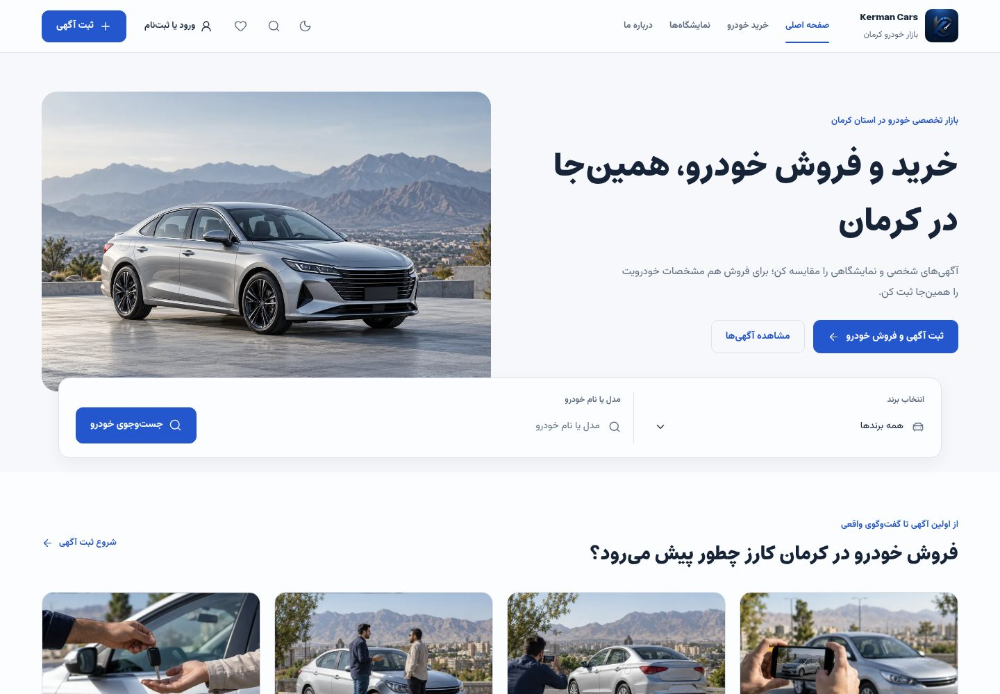

actual interface with isolated Django demo records; no real SMS or payment requests.

[Code 1](source/frontend/kerman-cars-frontend/src/pages/public/HomePage.jsx) · [Code 2](source/frontend/kerman-cars-frontend/src/router/AppRouter.jsx)

2. آگهی‌های خرید و فروش خودرو

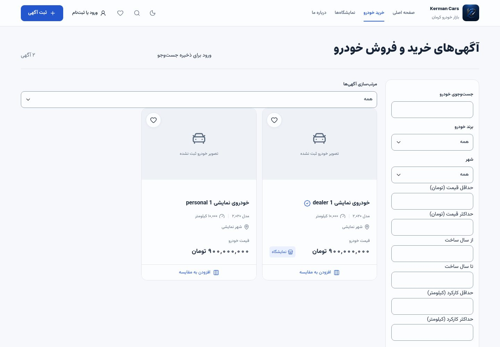

actual interface with isolated Django demo records; no real SMS or payment requests.

[Code 1](source/frontend/kerman-cars-frontend/src/pages/public/ListingsPage.jsx) · [Code 2](source/frontend/kerman-cars-frontend/src/router/AppRouter.jsx)

3. نمایشگاه‌های خودرو در کرمان

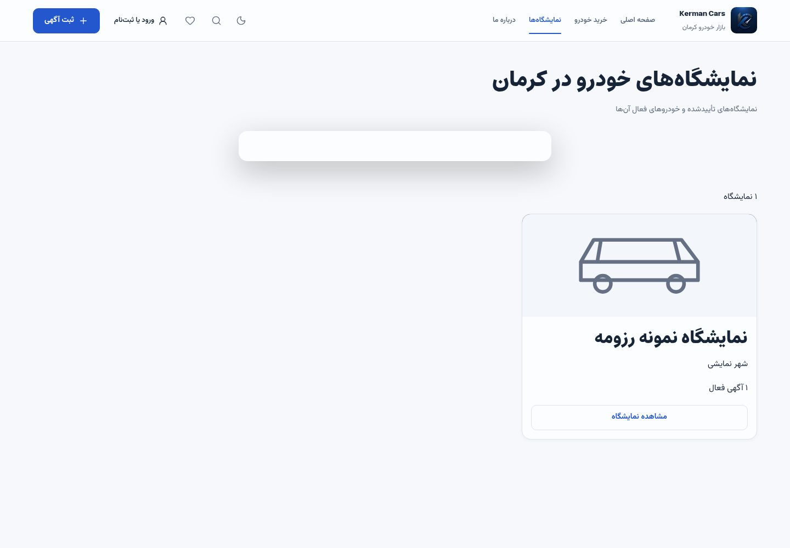

actual interface with isolated Django demo records; no real SMS or payment requests.

[Code 1](source/frontend/kerman-cars-frontend/src/pages/public/DealersPage.jsx) · [Code 2](source/frontend/kerman-cars-frontend/src/router/AppRouter.jsx)

4. مقایسه خودروها

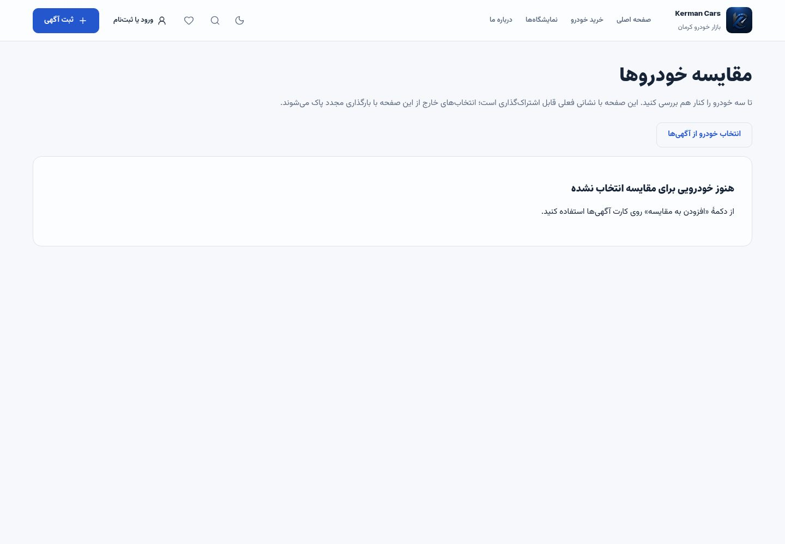

actual interface with isolated Django demo records; no real SMS or payment requests.

[Code 1](source/frontend/kerman-cars-frontend/src/pages/public/ComparisonPage.jsx) · [Code 2](source/frontend/kerman-cars-frontend/src/router/AppRouter.jsx)

5. مجلهٔ کرمان کارز

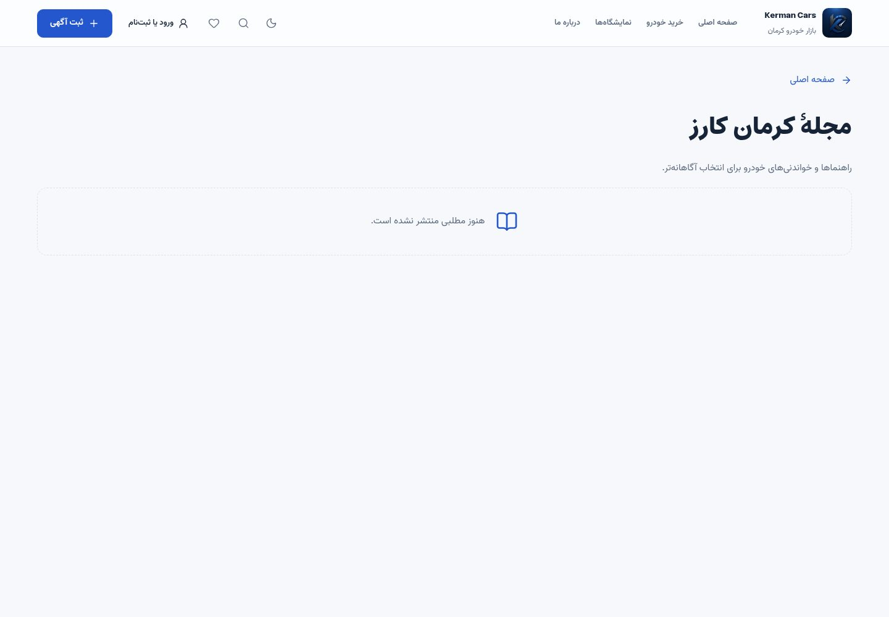

actual interface with isolated Django demo records; no real SMS or payment requests.

[Code 1](source/frontend/kerman-cars-frontend/src/pages/public/MagazinePage.jsx) · [Code 2](source/frontend/kerman-cars-frontend/src/router/AppRouter.jsx)

6. درباره ما

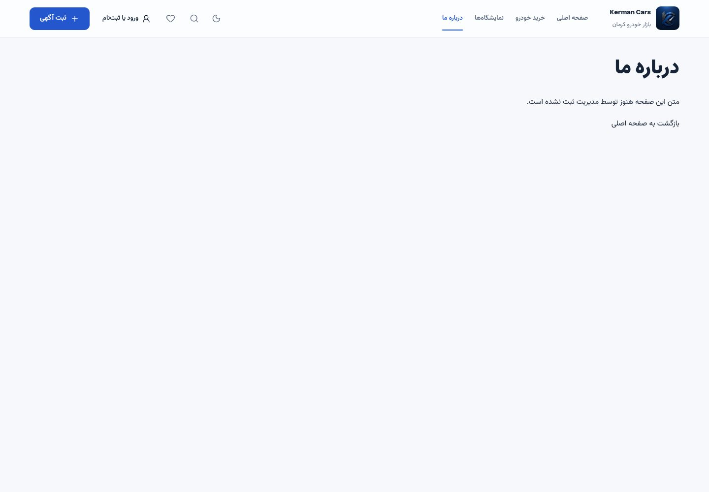

actual interface with isolated Django demo records; no real SMS or payment requests.

[Code 1](source/frontend/kerman-cars-frontend/src/pages/public/PublicInfoPage.jsx) · [Code 2](source/frontend/kerman-cars-frontend/src/router/AppRouter.jsx)

7. تماس با ما

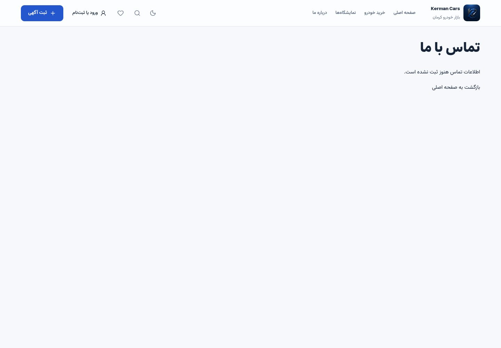

actual interface with isolated Django demo records; no real SMS or payment requests.

[Code 1](source/frontend/kerman-cars-frontend/src/pages/public/PublicInfoPage.jsx) · [Code 2](source/frontend/kerman-cars-frontend/src/router/AppRouter.jsx)

8. قوانین استفاده

actual interface with isolated Django demo records; no real SMS or payment requests.

[Code 1](source/frontend/kerman-cars-frontend/src/pages/public/PublicInfoPage.jsx) · [Code 2](source/frontend/kerman-cars-frontend/src/router/AppRouter.jsx)

9. حریم خصوصی

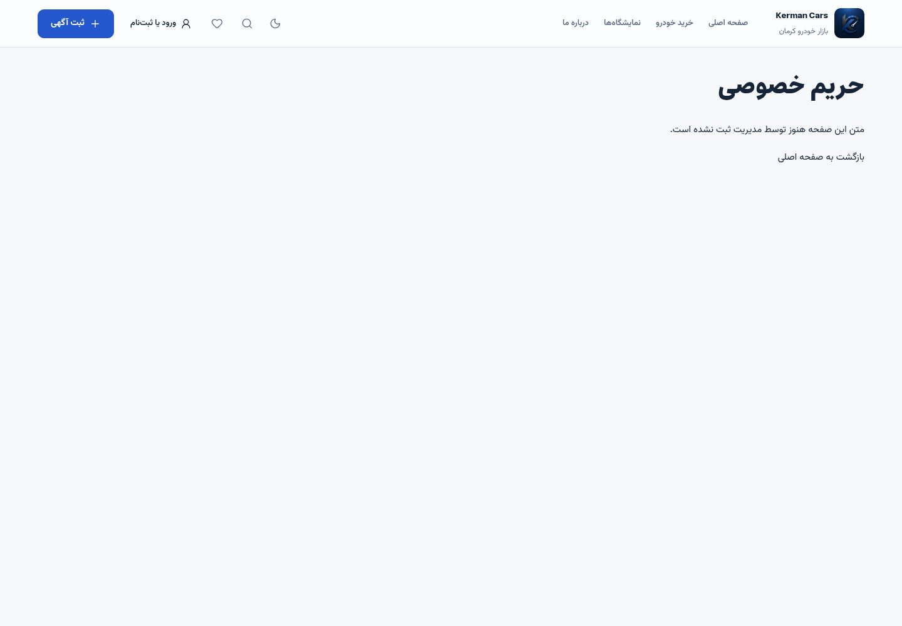

actual interface with isolated Django demo records; no real SMS or payment requests.

[Code 1](source/frontend/kerman-cars-frontend/src/pages/public/PublicInfoPage.jsx) · [Code 2](source/frontend/kerman-cars-frontend/src/router/AppRouter.jsx)

10. ورود یا ثبت‌نام

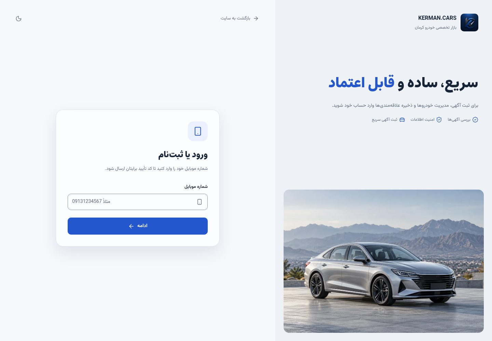

actual interface with isolated Django demo records; no real SMS or payment requests.

[Code 1](source/frontend/kerman-cars-frontend/src/pages/auth/LoginPage.jsx) · [Code 2](source/frontend/kerman-cars-frontend/src/router/AppRouter.jsx)

11. سلام کاربر

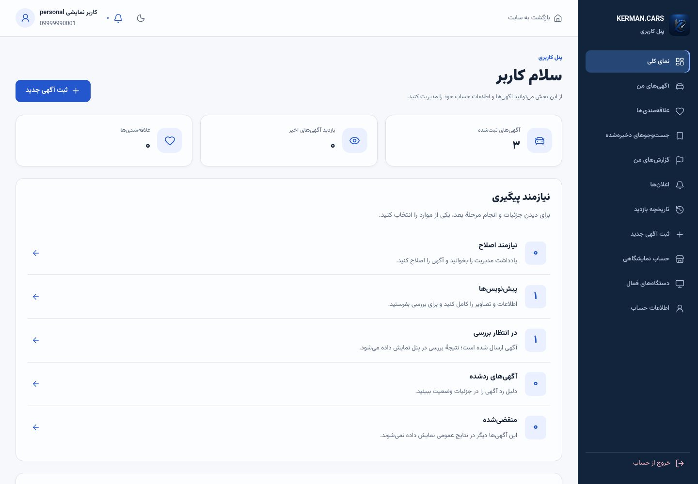

actual interface with isolated Django demo records; no real SMS or payment requests.

[Code 1](source/frontend/kerman-cars-frontend/src/pages/dashboard/DashboardHomePage.jsx) · [Code 2](source/frontend/kerman-cars-frontend/src/router/AppRouter.jsx)

12. آگهی‌های من

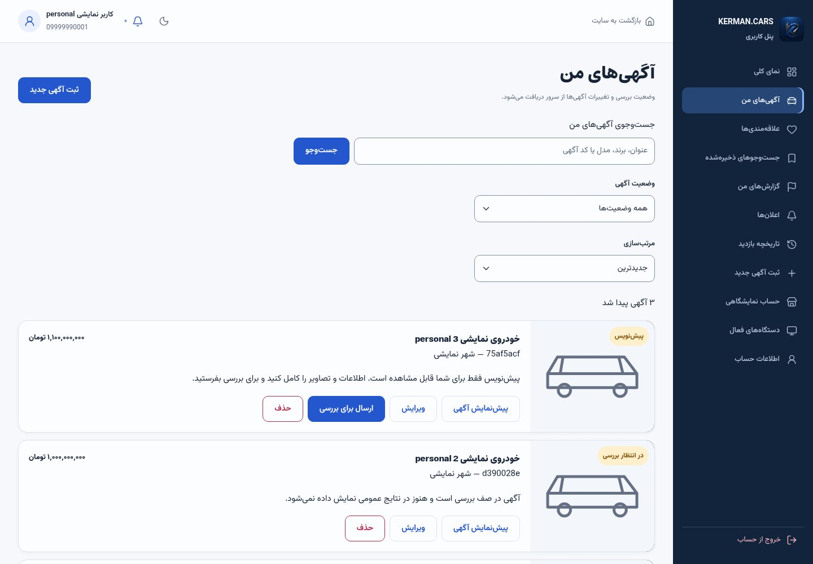

actual interface with isolated Django demo records; no real SMS or payment requests.

[Code 1](source/frontend/kerman-cars-frontend/src/pages/dashboard/MyListingsPage.jsx) · [Code 2](source/frontend/kerman-cars-frontend/src/router/AppRouter.jsx)

13. ثبت آگهی خودرو

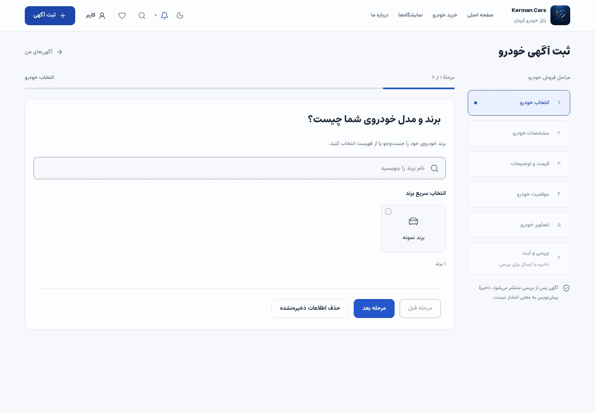

actual interface with isolated Django demo records; no real SMS or payment requests.

[Code 1](source/frontend/kerman-cars-frontend/src/pages/listing/CreateListingPage.jsx) · [Code 2](source/frontend/kerman-cars-frontend/src/router/AppRouter.jsx)

14. علاقه‌مندی‌های من

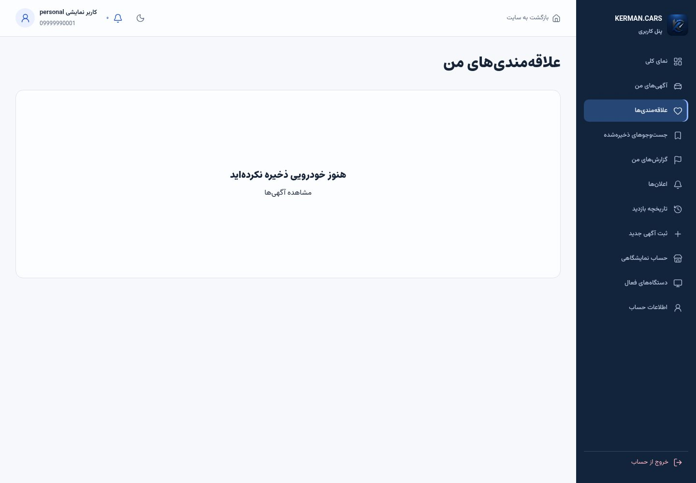

actual interface with isolated Django demo records; no real SMS or payment requests.

[Code 1](source/frontend/kerman-cars-frontend/src/pages/dashboard/FavoritesPage.jsx) · [Code 2](source/frontend/kerman-cars-frontend/src/router/AppRouter.jsx)

15. جست‌وجوهای ذخیره‌شده

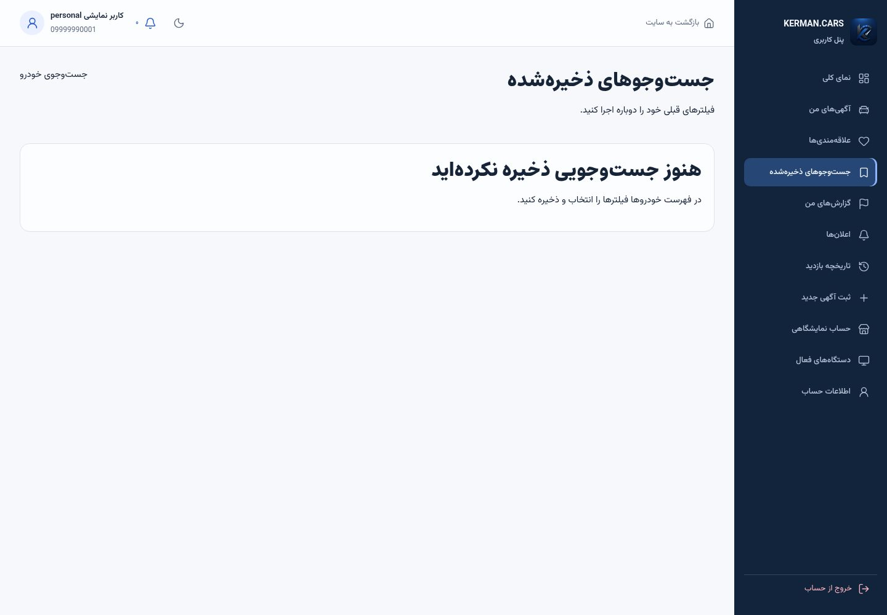

actual interface with isolated Django demo records; no real SMS or payment requests.

[Code 1](source/frontend/kerman-cars-frontend/src/pages/dashboard/SavedSearchesPage.jsx) · [Code 2](source/frontend/kerman-cars-frontend/src/router/AppRouter.jsx)

16. گزارش‌های من

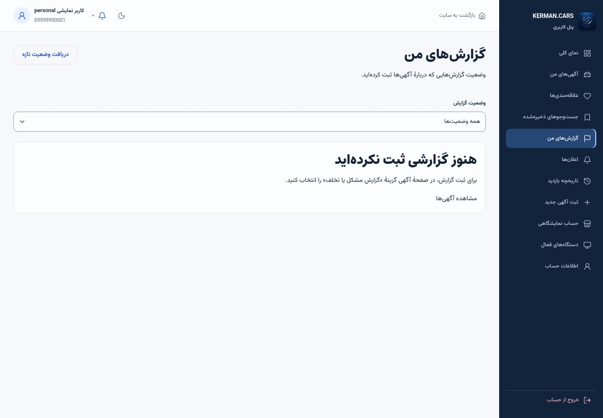

actual interface with isolated Django demo records; no real SMS or payment requests.

[Code 1](source/frontend/kerman-cars-frontend/src/pages/dashboard/MyReportsPage.jsx) · [Code 2](source/frontend/kerman-cars-frontend/src/router/AppRouter.jsx)

17. اعلان‌های من

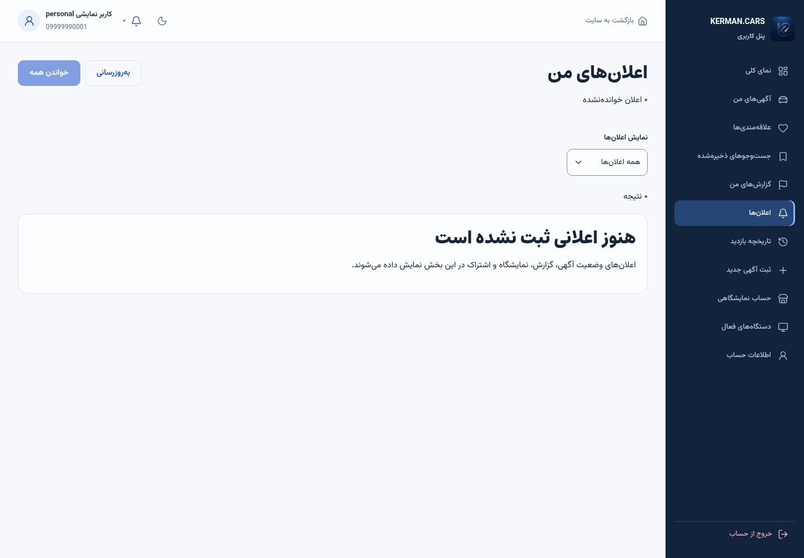

actual interface with isolated Django demo records; no real SMS or payment requests.

[Code 1](source/frontend/kerman-cars-frontend/src/pages/dashboard/NotificationsPage.jsx) · [Code 2](source/frontend/kerman-cars-frontend/src/router/AppRouter.jsx)

18. تاریخچه بازدید من

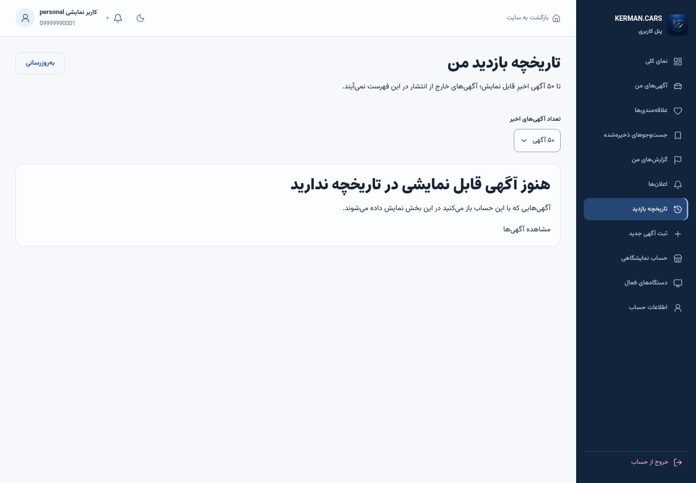

actual interface with isolated Django demo records; no real SMS or payment requests.

[Code 1](source/frontend/kerman-cars-frontend/src/pages/dashboard/ViewHistoryPage.jsx) · [Code 2](source/frontend/kerman-cars-frontend/src/router/AppRouter.jsx)

19. اطلاعات حساب

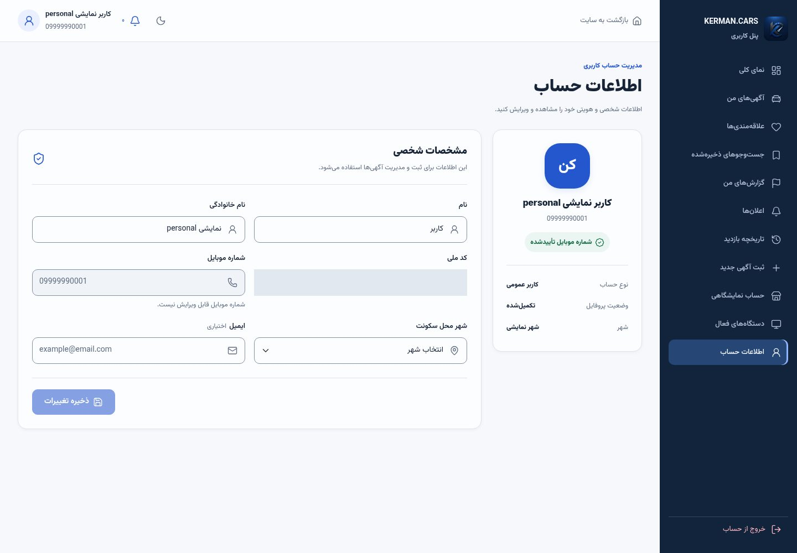

actual interface with isolated Django demo records; no real SMS or payment requests.

[Code 1](source/frontend/kerman-cars-frontend/src/pages/dashboard/ProfilePage.jsx) · [Code 2](source/frontend/kerman-cars-frontend/src/router/AppRouter.jsx)

20. دستگاه‌های فعال

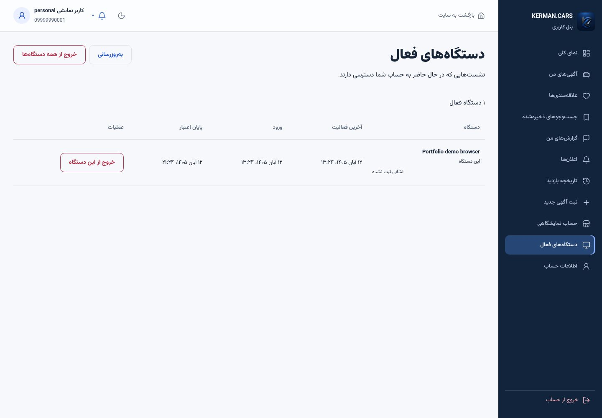

actual interface with isolated Django demo records; no real SMS or payment requests.

[Code 1](source/frontend/kerman-cars-frontend/src/pages/dashboard/SessionsPage.jsx) · [Code 2](source/frontend/kerman-cars-frontend/src/router/AppRouter.jsx)

21. ثبت درخواست نمایشگاه

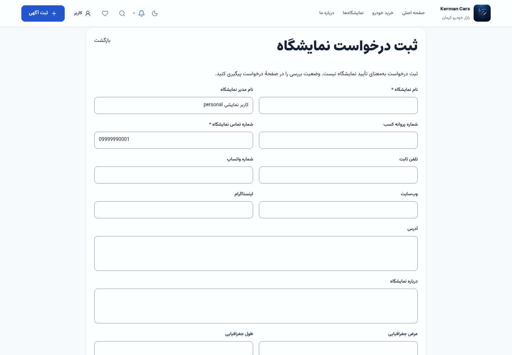

actual interface with isolated Django demo records; no real SMS or payment requests.

[Code 1](source/frontend/kerman-cars-frontend/src/pages/dealer/DealerRegistrationPage.jsx) · [Code 2](source/frontend/kerman-cars-frontend/src/router/AppRouter.jsx)

22. نمایشگاه نمونه رزومه

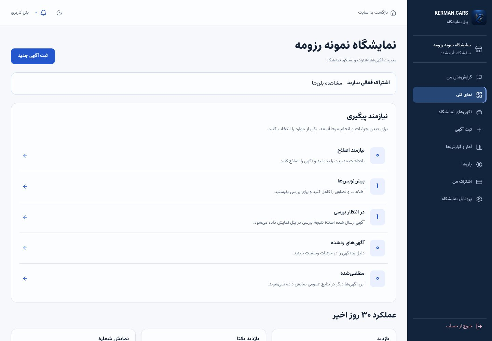

actual interface with isolated Django demo records; no real SMS or payment requests.

[Code 1](source/frontend/kerman-cars-frontend/src/pages/dealer/DealerDashboardPage.jsx) · [Code 2](source/frontend/kerman-cars-frontend/src/router/AppRouter.jsx)

23. آگهی‌های من

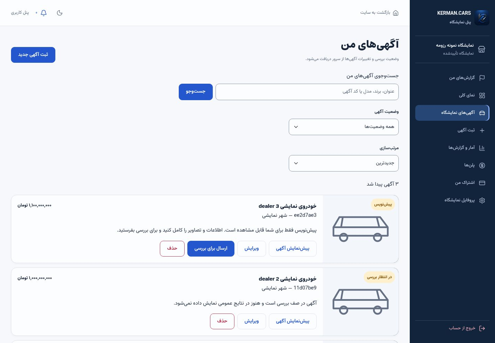

actual interface with isolated Django demo records; no real SMS or payment requests.

[Code 1](source/frontend/kerman-cars-frontend/src/pages/dealer/DealerListingsPage.jsx) · [Code 2](source/frontend/kerman-cars-frontend/src/router/AppRouter.jsx)

24. آمار و گزارش‌های نمایشگاه

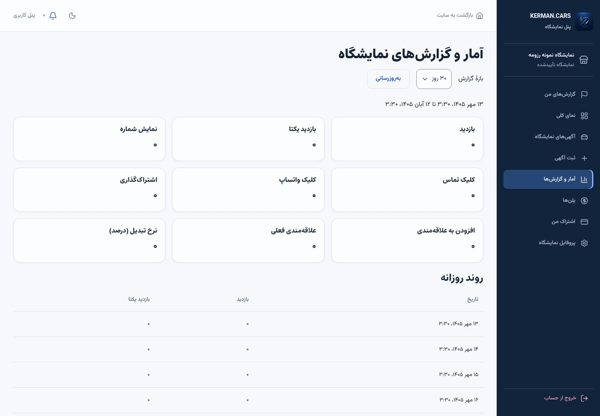

actual interface with isolated Django demo records; no real SMS or payment requests.

[Code 1](source/frontend/kerman-cars-frontend/src/pages/dealer/DealerAnalyticsPage.jsx) · [Code 2](source/frontend/kerman-cars-frontend/src/router/AppRouter.jsx)

25. پلن‌های نمایشگاه

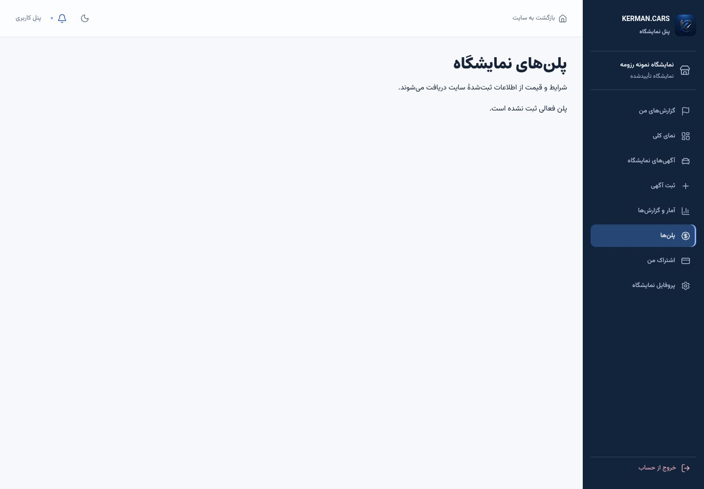

actual interface with isolated Django demo records; no real SMS or payment requests.

[Code 1](source/frontend/kerman-cars-frontend/src/pages/dealer/DealerPlansPage.jsx) · [Code 2](source/frontend/kerman-cars-frontend/src/router/AppRouter.jsx)

26. اشتراک من

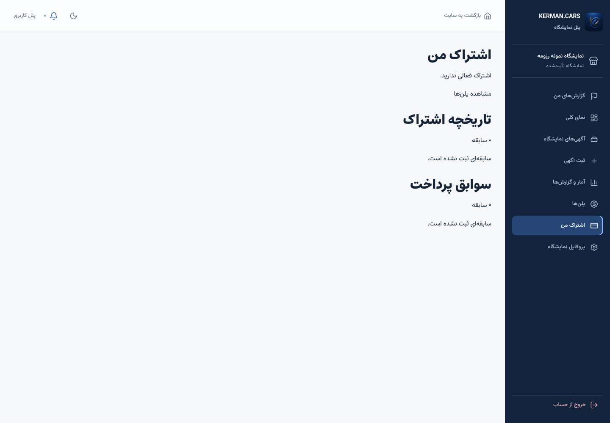

actual interface with isolated Django demo records; no real SMS or payment requests.

[Code 1](source/frontend/kerman-cars-frontend/src/pages/dealer/DealerSubscriptionPage.jsx) · [Code 2](source/frontend/kerman-cars-frontend/src/router/AppRouter.jsx)

27. ویرایش اطلاعات نمایشگاه

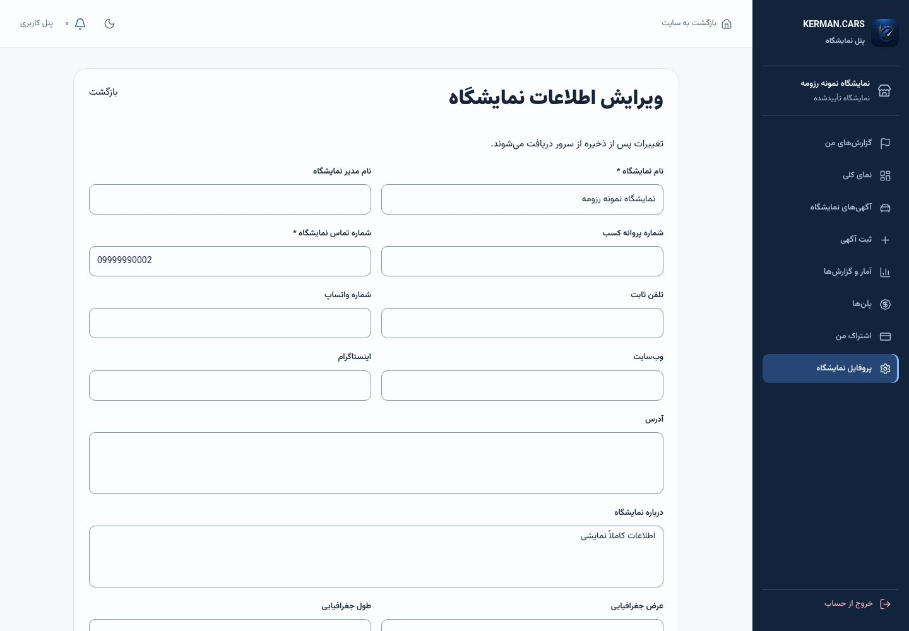

actual interface with isolated Django demo records; no real SMS or payment requests.

[Code 1](source/frontend/kerman-cars-frontend/src/pages/dealer/DealerProfilePage.jsx) · [Code 2](source/frontend/kerman-cars-frontend/src/router/AppRouter.jsx)

28. داشبورد مدیریت

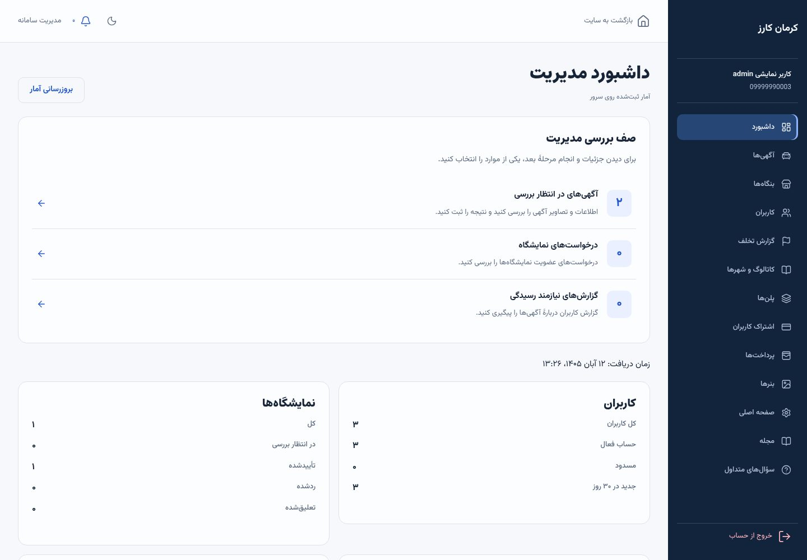

actual interface with isolated Django demo records; no real SMS or payment requests.

[Code 1](source/frontend/kerman-cars-frontend/src/pages/admin/AdminDashboardPage.jsx) · [Code 2](source/frontend/kerman-cars-frontend/src/router/AppRouter.jsx)

29. مدیریت آگهی‌ها

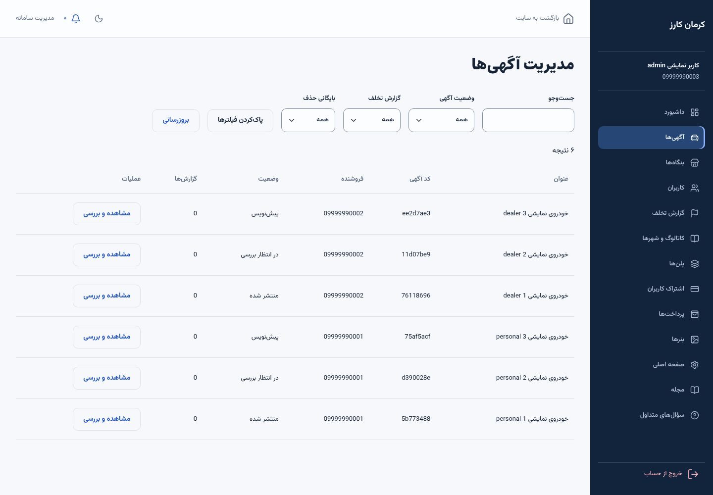

actual interface with isolated Django demo records; no real SMS or payment requests.

[Code 1](source/frontend/kerman-cars-frontend/src/pages/admin/AdminListingsPage.jsx) · [Code 2](source/frontend/kerman-cars-frontend/src/router/AppRouter.jsx)

30. درخواست‌ها و نمایشگاه‌ها

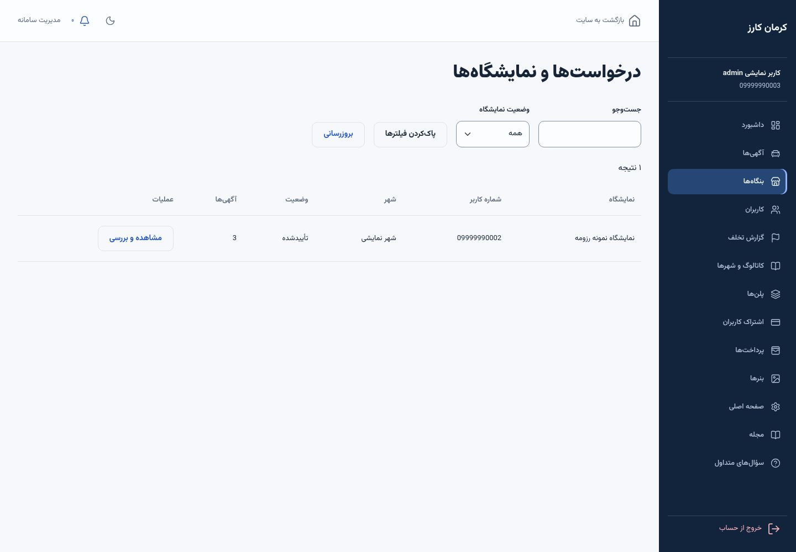

actual interface with isolated Django demo records; no real SMS or payment requests.

[Code 1](source/frontend/kerman-cars-frontend/src/pages/admin/AdminDealersPage.jsx) · [Code 2](source/frontend/kerman-cars-frontend/src/router/AppRouter.jsx)

31. مدیریت کاربران

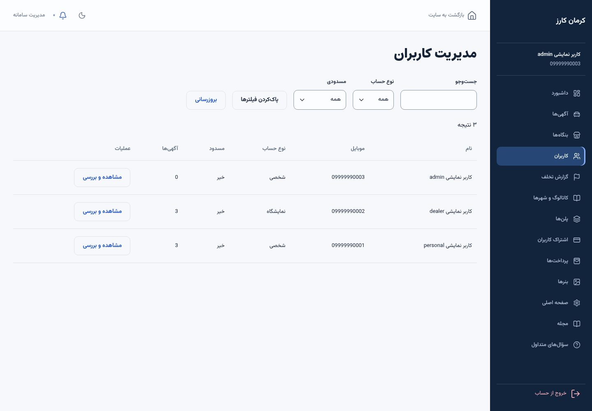

actual interface with isolated Django demo records; no real SMS or payment requests.

[Code 1](source/frontend/kerman-cars-frontend/src/pages/admin/AdminUsersPage.jsx) · [Code 2](source/frontend/kerman-cars-frontend/src/router/AppRouter.jsx)

32. گزارش‌های تخلف

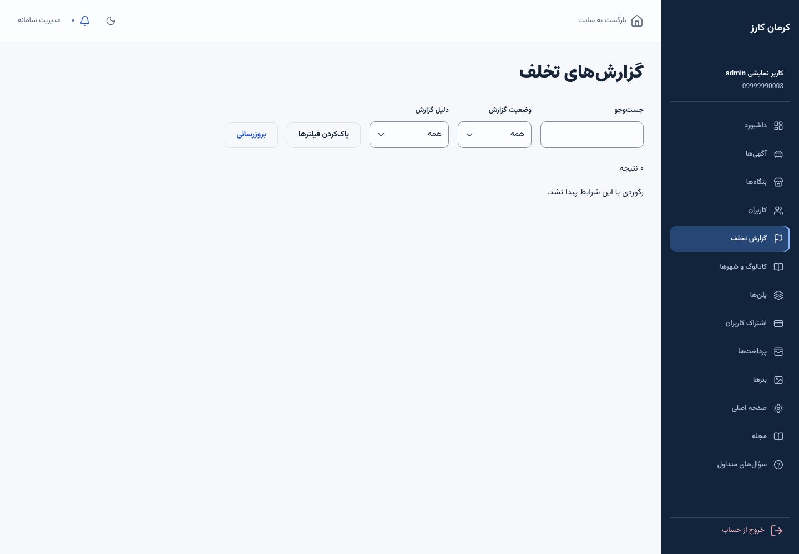

actual interface with isolated Django demo records; no real SMS or payment requests.

[Code 1](source/frontend/kerman-cars-frontend/src/pages/admin/AdminRecordPages.jsx) · [Code 2](source/frontend/kerman-cars-frontend/src/router/AppRouter.jsx)

33. اشتراک کاربران

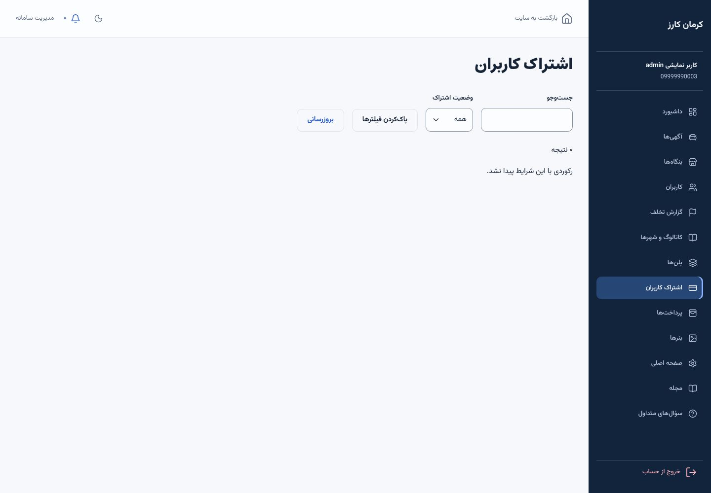

actual interface with isolated Django demo records; no real SMS or payment requests.

[Code 1](source/frontend/kerman-cars-frontend/src/pages/admin/AdminRecordPages.jsx) · [Code 2](source/frontend/kerman-cars-frontend/src/router/AppRouter.jsx)

34. پرداخت‌ها

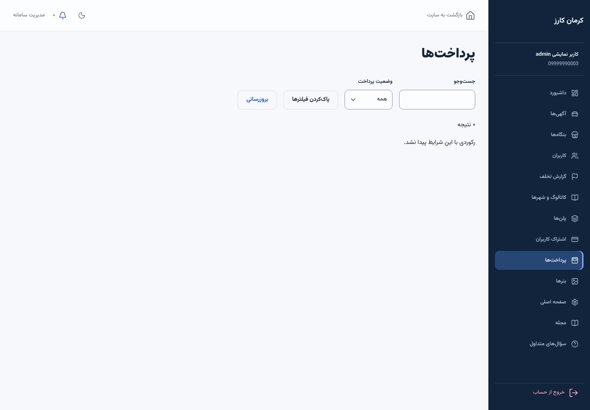

actual interface with isolated Django demo records; no real SMS or payment requests.

[Code 1](source/frontend/kerman-cars-frontend/src/pages/admin/AdminRecordPages.jsx) · [Code 2](source/frontend/kerman-cars-frontend/src/router/AppRouter.jsx)

35. پلن‌های نمایشگاهی

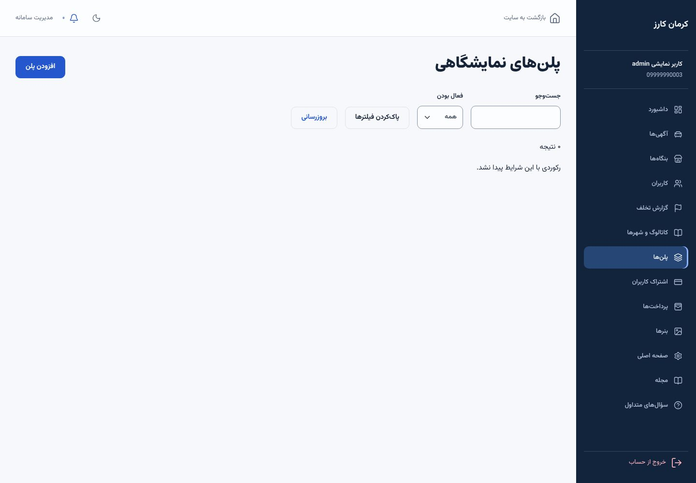

actual interface with isolated Django demo records; no real SMS or payment requests.

[Code 1](source/frontend/kerman-cars-frontend/src/pages/admin/AdminPlansPage.jsx) · [Code 2](source/frontend/kerman-cars-frontend/src/router/AppRouter.jsx)

36. افزودن پلن

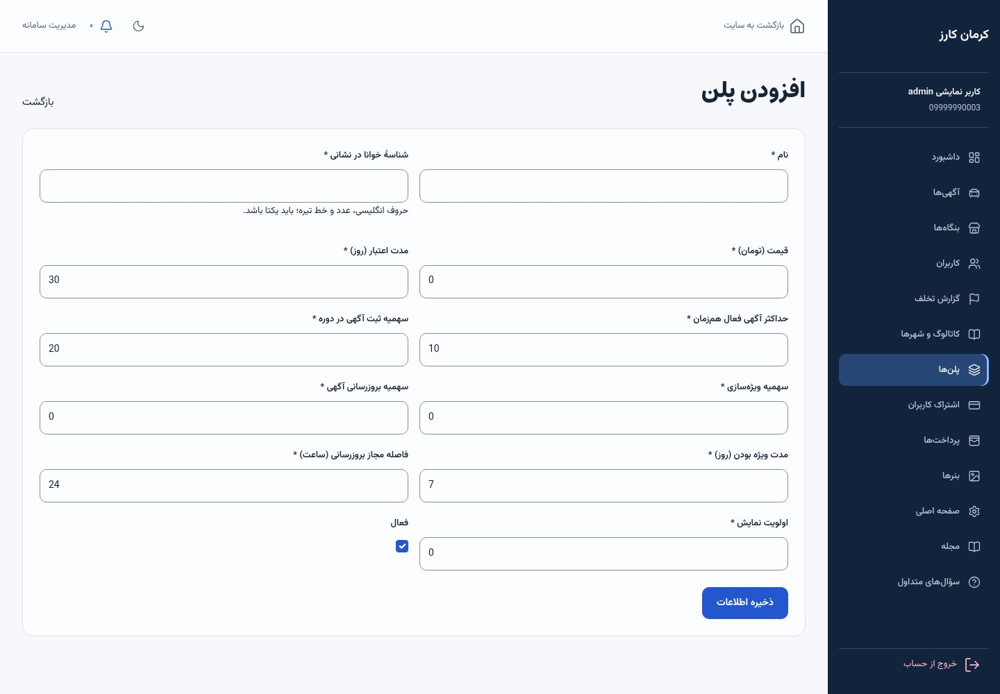

actual interface with isolated Django demo records; no real SMS or payment requests.

[Code 1](source/frontend/kerman-cars-frontend/src/pages/admin/AdminResourcePages.jsx) · [Code 2](source/frontend/kerman-cars-frontend/src/router/AppRouter.jsx)

37. بنرهای صفحه اصلی

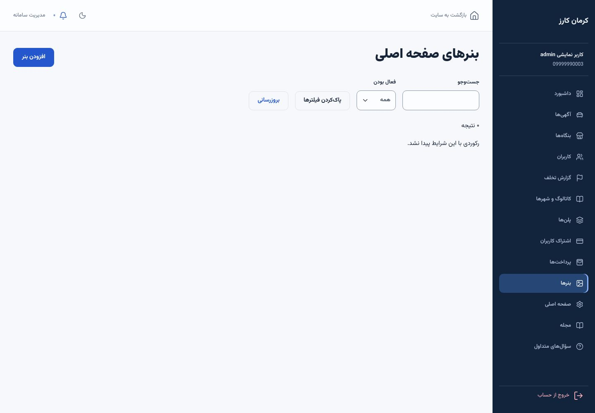

actual interface with isolated Django demo records; no real SMS or payment requests.

[Code 1](source/frontend/kerman-cars-frontend/src/pages/admin/AdminResourcePages.jsx) · [Code 2](source/frontend/kerman-cars-frontend/src/router/AppRouter.jsx)

38. افزودن بنر

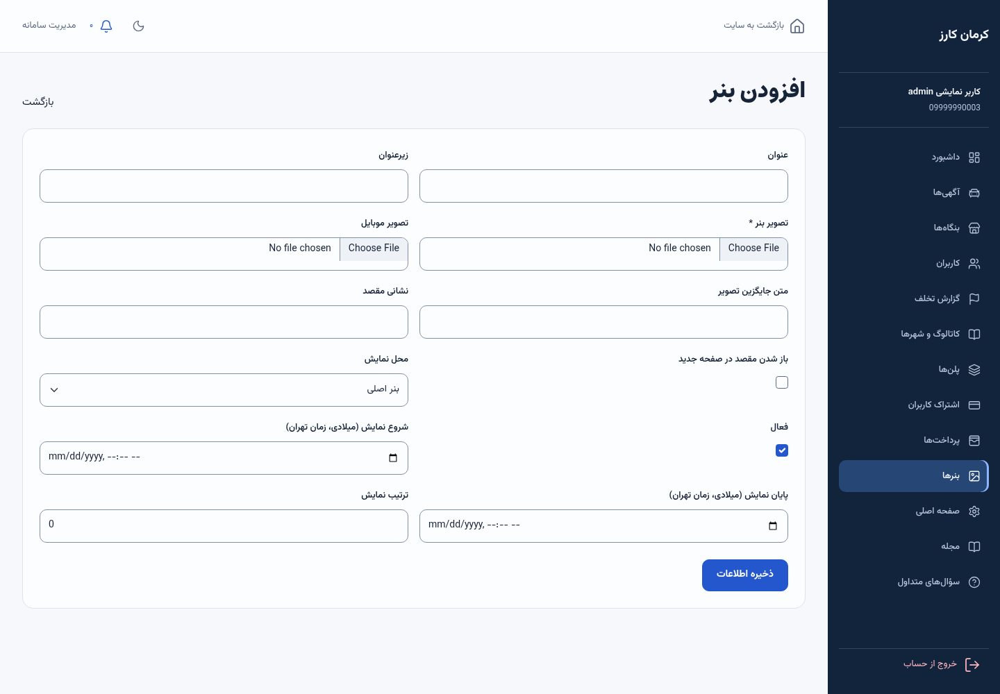

actual interface with isolated Django demo records; no real SMS or payment requests.

[Code 1](source/frontend/kerman-cars-frontend/src/pages/admin/AdminResourcePages.jsx) · [Code 2](source/frontend/kerman-cars-frontend/src/router/AppRouter.jsx)

39. برندهای خودرو

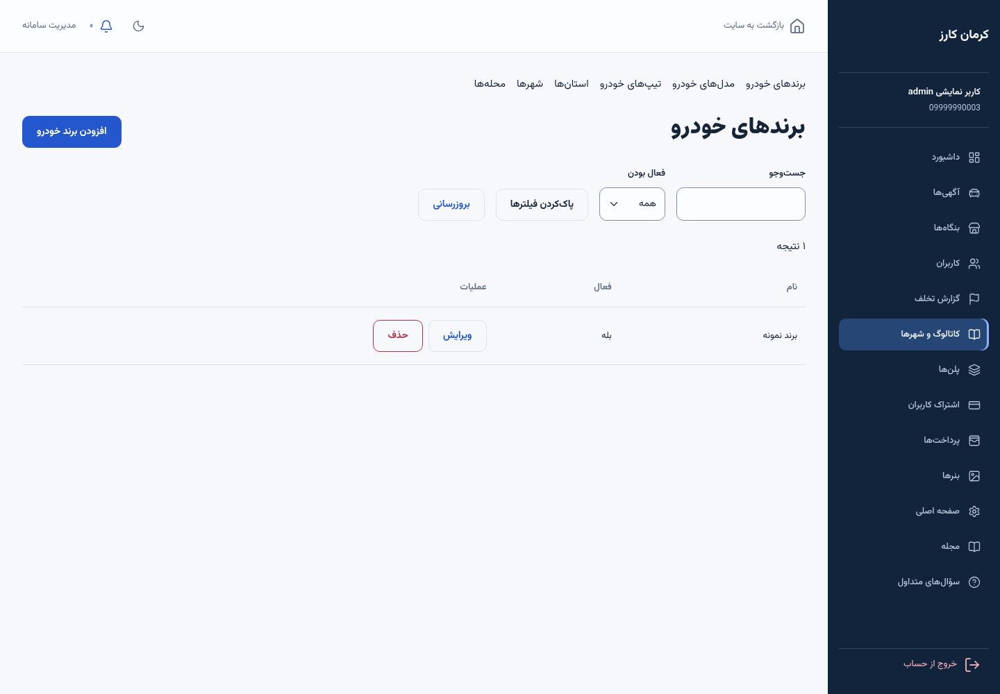

actual interface with isolated Django demo records; no real SMS or payment requests.

[Code 1](source/frontend/kerman-cars-frontend/src/pages/admin/AdminResourcePages.jsx) · [Code 2](source/frontend/kerman-cars-frontend/src/router/AppRouter.jsx)

40. مدل‌های خودرو

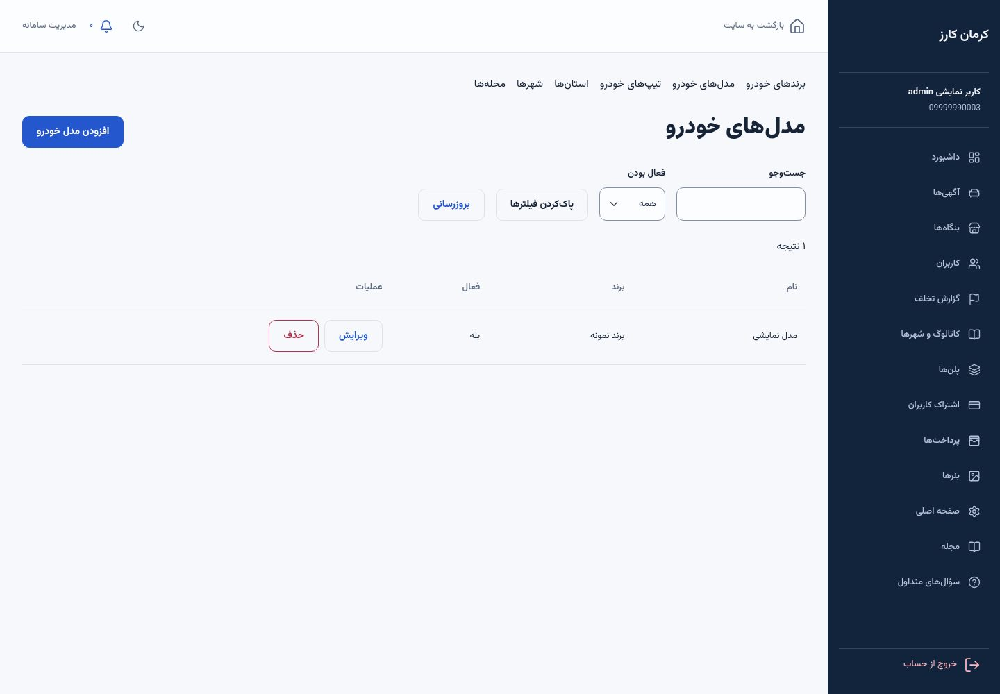

actual interface with isolated Django demo records; no real SMS or payment requests.

[Code 1](source/frontend/kerman-cars-frontend/src/pages/admin/AdminResourcePages.jsx) · [Code 2](source/frontend/kerman-cars-frontend/src/router/AppRouter.jsx)

41. تیپ‌های خودرو

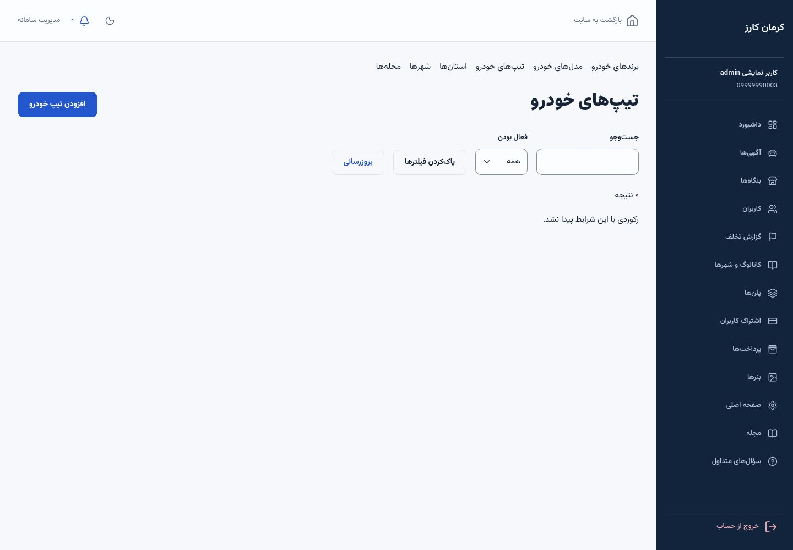

actual interface with isolated Django demo records; no real SMS or payment requests.

[Code 1](source/frontend/kerman-cars-frontend/src/pages/admin/AdminResourcePages.jsx) · [Code 2](source/frontend/kerman-cars-frontend/src/router/AppRouter.jsx)

42. تنظیمات صفحه اصلی

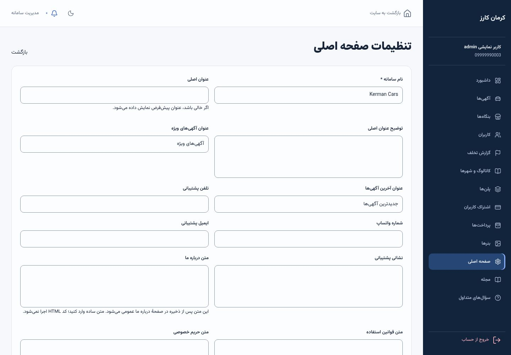

actual interface with isolated Django demo records; no real SMS or payment requests.

[Code 1](source/frontend/kerman-cars-frontend/src/pages/admin/AdminSettingsPage.jsx) · [Code 2](source/frontend/kerman-cars-frontend/src/router/AppRouter.jsx)

43. استان‌ها

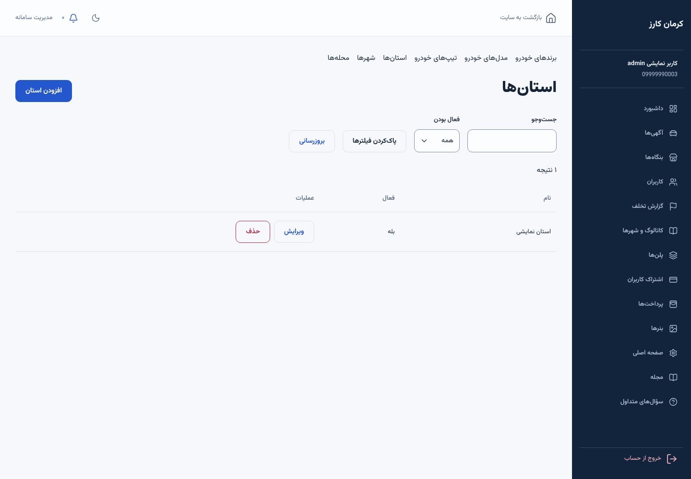

actual interface with isolated Django demo records; no real SMS or payment requests.

[Code 1](source/frontend/kerman-cars-frontend/src/pages/admin/AdminResourcePages.jsx) · [Code 2](source/frontend/kerman-cars-frontend/src/router/AppRouter.jsx)

44. شهرها

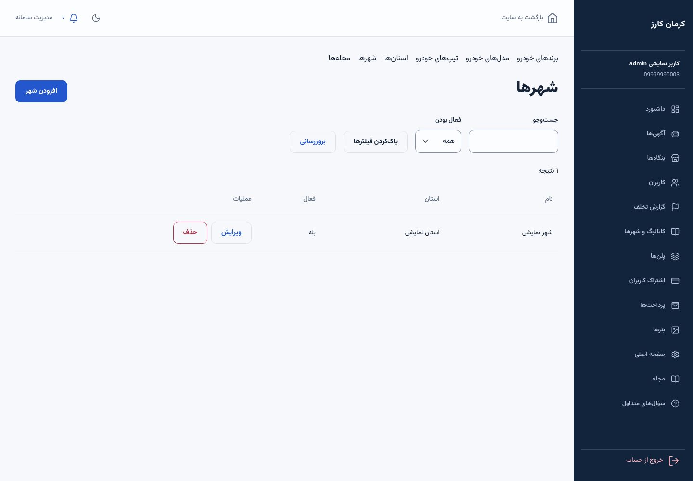

actual interface with isolated Django demo records; no real SMS or payment requests.

[Code 1](source/frontend/kerman-cars-frontend/src/pages/admin/AdminResourcePages.jsx) · [Code 2](source/frontend/kerman-cars-frontend/src/router/AppRouter.jsx)

45. محله‌ها

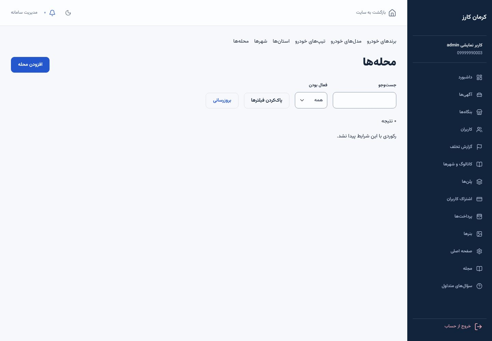

actual interface with isolated Django demo records; no real SMS or payment requests.

[Code 1](source/frontend/kerman-cars-frontend/src/pages/admin/AdminResourcePages.jsx) · [Code 2](source/frontend/kerman-cars-frontend/src/router/AppRouter.jsx)

46. مجله کرمان کارز

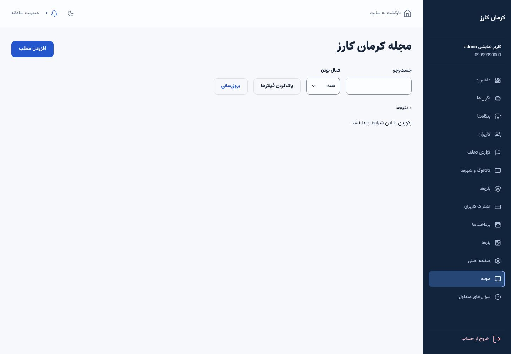

actual interface with isolated Django demo records; no real SMS or payment requests.

[Code 1](source/frontend/kerman-cars-frontend/src/pages/admin/AdminResourcePages.jsx) · [Code 2](source/frontend/kerman-cars-frontend/src/router/AppRouter.jsx)

47. افزودن مطلب

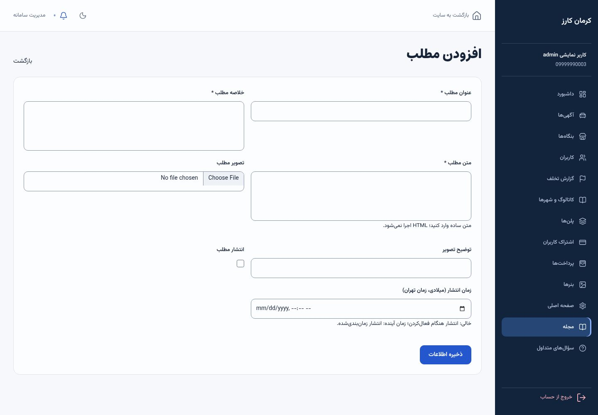

actual interface with isolated Django demo records; no real SMS or payment requests.

[Code 1](source/frontend/kerman-cars-frontend/src/pages/admin/AdminResourcePages.jsx) · [Code 2](source/frontend/kerman-cars-frontend/src/router/AppRouter.jsx)

48. سؤال‌های متداول

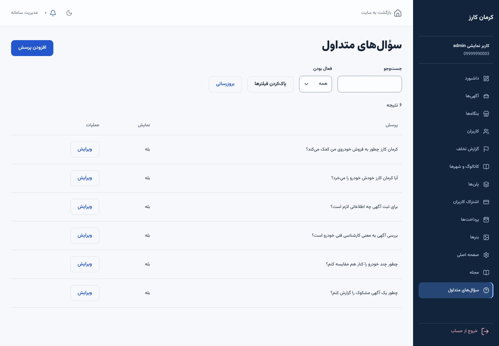

actual interface with isolated Django demo records; no real SMS or payment requests.

[Code 1](source/frontend/kerman-cars-frontend/src/pages/admin/AdminResourcePages.jsx) · [Code 2](source/frontend/kerman-cars-frontend/src/router/AppRouter.jsx)

49. افزودن پرسش

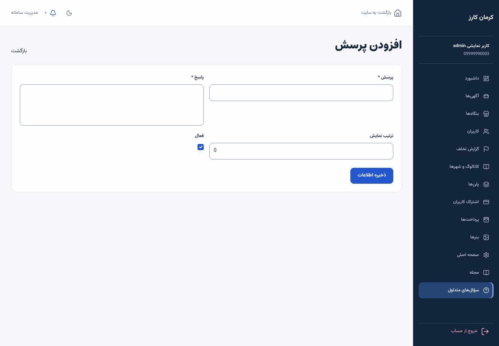

actual interface with isolated Django demo records; no real SMS or payment requests.

[Code 1](source/frontend/kerman-cars-frontend/src/pages/admin/AdminResourcePages.jsx) · [Code 2](source/frontend/kerman-cars-frontend/src/router/AppRouter.jsx)

50. افزودن برند خودرو

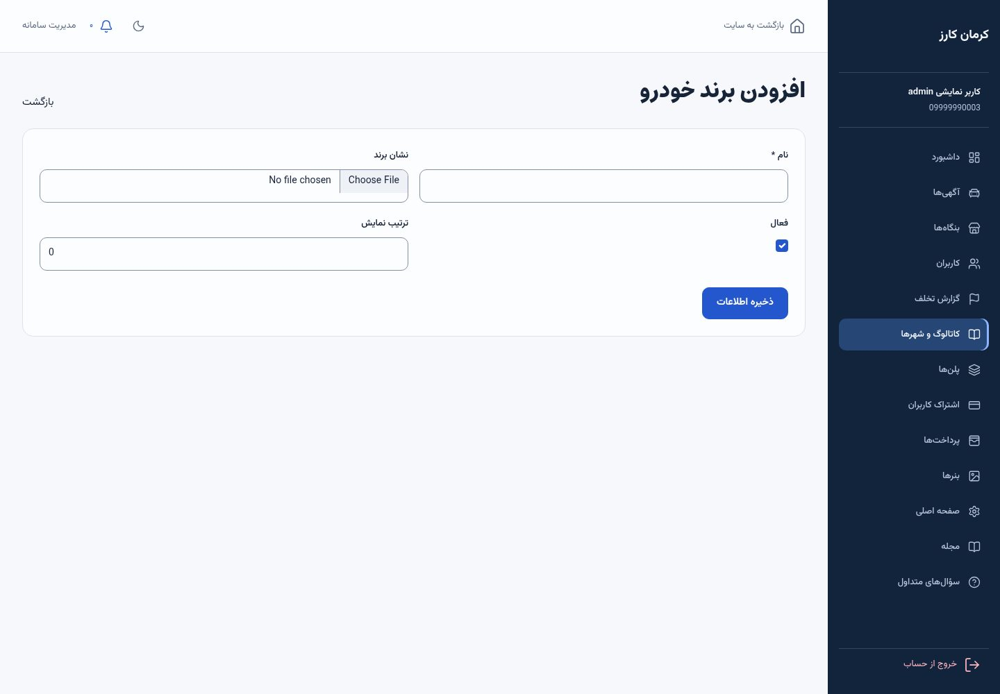

actual interface with isolated Django demo records; no real SMS or payment requests.

[Code 1](source/frontend/kerman-cars-frontend/src/pages/admin/AdminResourcePages.jsx) · [Code 2](source/frontend/kerman-cars-frontend/src/router/AppRouter.jsx)

51. افزودن مدل خودرو

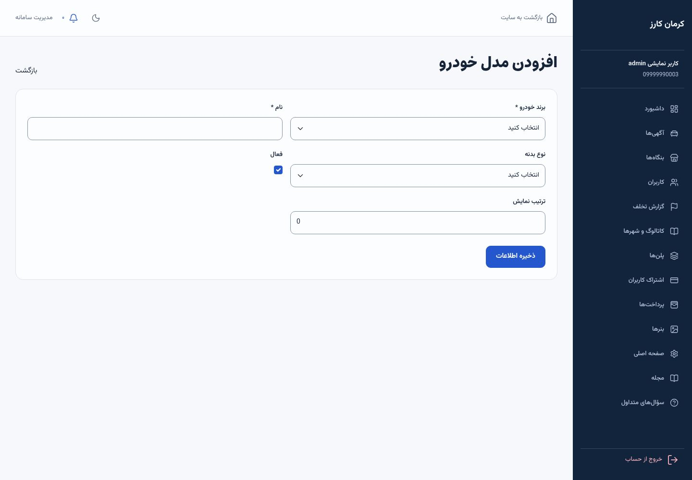

actual interface with isolated Django demo records; no real SMS or payment requests.

[Code 1](source/frontend/kerman-cars-frontend/src/pages/admin/AdminResourcePages.jsx) · [Code 2](source/frontend/kerman-cars-frontend/src/router/AppRouter.jsx)

52. افزودن تیپ خودرو

actual interface with isolated Django demo records; no real SMS or payment requests.

[Code 1](source/frontend/kerman-cars-frontend/src/pages/admin/AdminResourcePages.jsx) · [Code 2](source/frontend/kerman-cars-frontend/src/router/AppRouter.jsx)

53. افزودن استان

actual interface with isolated Django demo records; no real SMS or payment requests.

[Code 1](source/frontend/kerman-cars-frontend/src/pages/admin/AdminResourcePages.jsx) · [Code 2](source/frontend/kerman-cars-frontend/src/router/AppRouter.jsx)

54. افزودن شهر

actual interface with isolated Django demo records; no real SMS or payment requests.

[Code 1](source/frontend/kerman-cars-frontend/src/pages/admin/AdminResourcePages.jsx) · [Code 2](source/frontend/kerman-cars-frontend/src/router/AppRouter.jsx)

55. افزودن محله

actual interface with isolated Django demo records; no real SMS or payment requests.

[Code 1](source/frontend/kerman-cars-frontend/src/pages/admin/AdminResourcePages.jsx) · [Code 2](source/frontend/kerman-cars-frontend/src/router/AppRouter.jsx)

