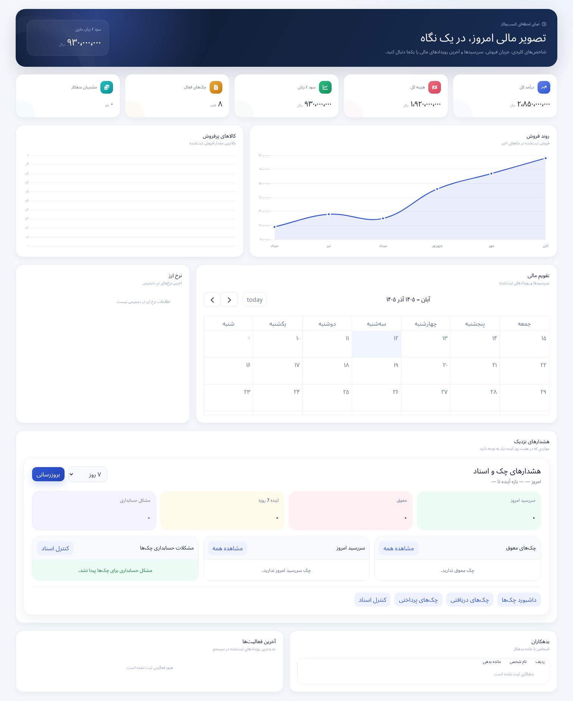

# Local Accounting — ERP Workspace

**[Browse every captured tab and its code](COVERAGE.md) · [Full screenshot gallery](GALLERY.md) · [All 243 source files](SOURCE_INDEX.md)**

A business accounting and inventory workspace covering catalog management, warehouse operations, financial reporting, treasury, sales and purchases. This public selection concentrates on presentation and operational forms; ledger posting and financial invariants remain outside the expanded source release.

**Stack:** React 19 · Vite 7 · Django backend · Chart.js · Persian calendar tooling

[← Profile](../../README.md) · [All project showcases](../README.md)

## Expanded source

This collection contains **243 complete source files**. Files retain their original paths; any neutral school-identity or contact-placeholder substitutions are recorded in the manifest. It is a reading-oriented source selection, not a standalone runnable application. Imports into omitted modules are intentionally retained.

- Dashboard chart composition and reporting UI.
- Inventory receipts, warehouse stock and stock-taking screens.
- Product management, barcode and price-list presentation.
- Reusable ERP controls, date inputs, focus management and table helpers.

### Start reading

- [Dashboard](source/frontend/vet_clinic/src/Pages/Dashboard/Dashboard.jsx)
- [Inventory table](source/frontend/vet_clinic/src/Pages/Inventory/InventoryTable.jsx)
- [Stock-taking form](source/frontend/vet_clinic/src/Pages/Inventory/StockTakingCreate.jsx)
- [Form error helpers](source/frontend/vet_clinic/src/utils/formErrors.js)

Browse the [complete file index](SOURCE_INDEX.md) and [source manifest](SOURCE_MANIFEST.json), which records the exact source revision (or uploaded archive) and SHA-256 of every copied file. No repository-wide license grant is added by this selection; retain existing notices when reviewing the source.

## Interface gallery

Existing Dashboard component rendered in isolation with synthetic API responses. This is a component preview, not a live financial database.

Narrow-viewport capture of the same component preview.

## Publication boundary

This public selection excludes credentials, environment/deployment configuration, databases, backups, uploaded customer files, authentication/session internals, tenant enforcement, payment-provider code and private business orchestration. Code referring to those omitted modules does not include their implementation.

## Verification scope

Published-file hashes and Python / JavaScript / TypeScript syntax are checked as part of portfolio preparation. Interface captures demonstrate presentation only; they do not establish backend integration, concurrency correctness or production readiness.

The source application entry point currently fails with `Cannot access lazy before initialization`. Captures therefore render the existing dashboard component separately; the entry-point issue is not repaired or hidden by this source selection. See also the earlier [ERP domain excerpts](../erp-accounting-real/README.md).
