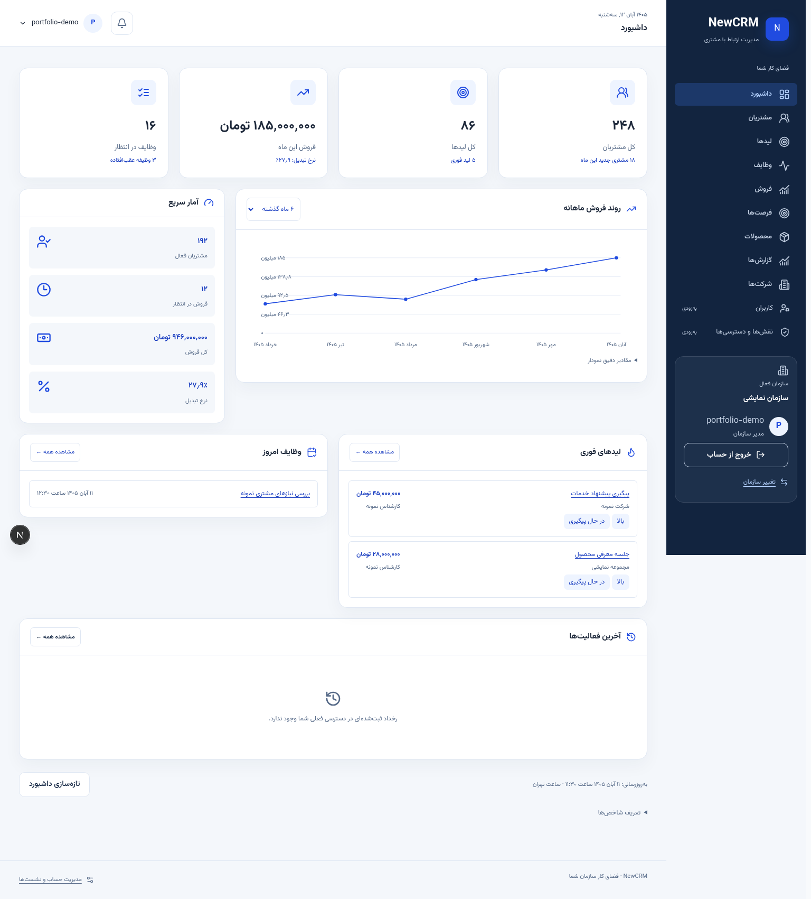
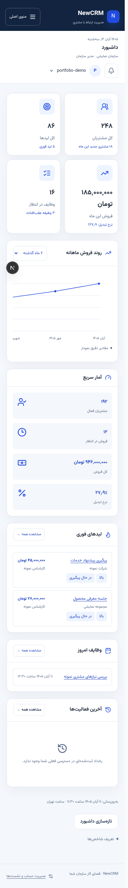

# NewCRM — Multi-Organization Sales Workspace

**[Browse every captured tab and its code](COVERAGE.md) · [Full screenshot gallery](GALLERY.md) · [All 97 source files](SOURCE_INDEX.md)**

A Persian RTL CRM built around organization-specific customer records, lead management, opportunities, orders, activities, and reports. This is a separate project from the earlier CRM / sales-operations showcase.

**Stack:** Next.js 16.4 · React 19 · TypeScript · Django 5.2 · Django REST Framework

[← Profile](../../README.md) · [All project showcases](../README.md)

## Expanded source

This collection contains **97 complete source files**. Files retain their original paths; any neutral school-identity or contact-placeholder substitutions are recorded in the manifest. It is a reading-oriented source selection, not a standalone runnable application. Imports into omitted modules are intentionally retained.

- Customer and company workspaces, related records, timeline and import-preview UI.
- Lead workspace, sales pipeline summary, order entry and product workspace.
- Organization-aware client calls, cancellation and draft navigation helpers.
- Complete customer, lead, product and activity model/serializer samples.

### Start reading

- [Customer workspace](source/frontend/components/customer-workspace.tsx)
- [Dashboard and sales trend](source/frontend/components/reference-dashboard.tsx)
- [Lead workflow](source/frontend/components/lead-workspace.tsx)
- [Exact money and Persian date inputs](source/frontend/lib/sales-entry.ts)
- [Contact normalization](source/backend/customers/normalization.py)

Browse the [complete file index](SOURCE_INDEX.md) and [source manifest](SOURCE_MANIFEST.json), which records the exact source revision (or uploaded archive) and SHA-256 of every copied file. No repository-wide license grant is added by this selection; retain existing notices when reviewing the source.

## Interface gallery

Actual NewCRM dashboard with synthetic API responses. Numbers and organization names are demonstration data.

The same real interface at a narrow viewport with synthetic data.

## Publication boundary

This public selection excludes credentials, environment/deployment configuration, databases, backups, uploaded customer files, authentication/session internals, tenant enforcement, payment-provider code and private business orchestration. Code referring to those omitted modules does not include their implementation.

## Verification scope

Published-file hashes and Python / JavaScript / TypeScript syntax are checked as part of portfolio preparation. Interface captures demonstrate presentation only; they do not establish backend integration, concurrency correctness or production readiness.

The existing money/date boundary test is included at `source/frontend/tests/sales-entry.cjs`; run it with a current Node.js version supporting TypeScript stripping: `node source/frontend/tests/sales-entry.cjs`. The earlier CRM showcase remains [separate](../crm-real/README.md).
