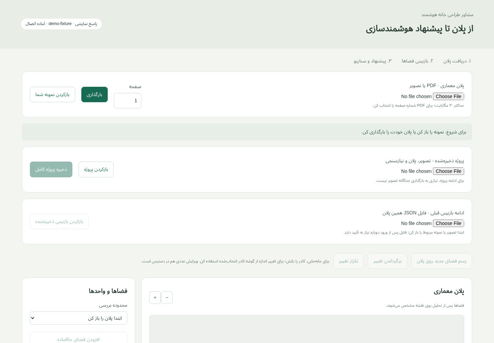
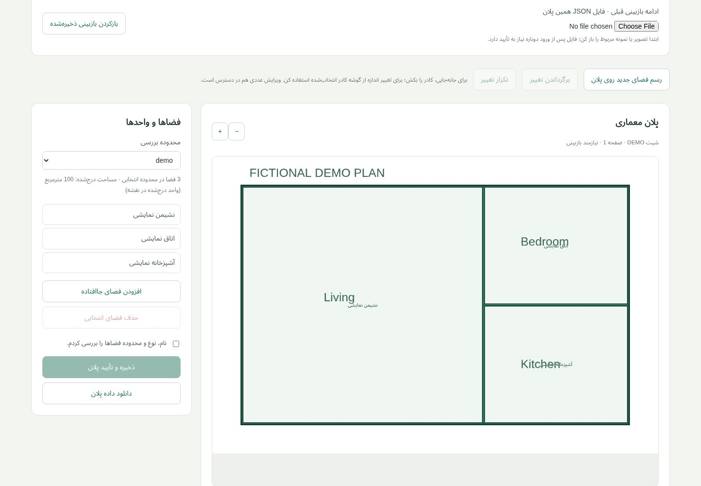
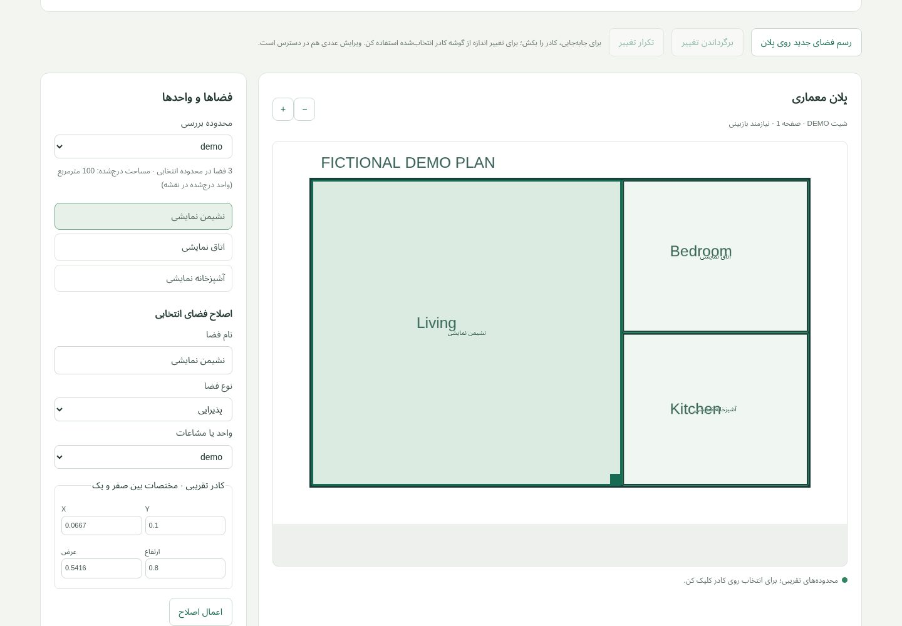
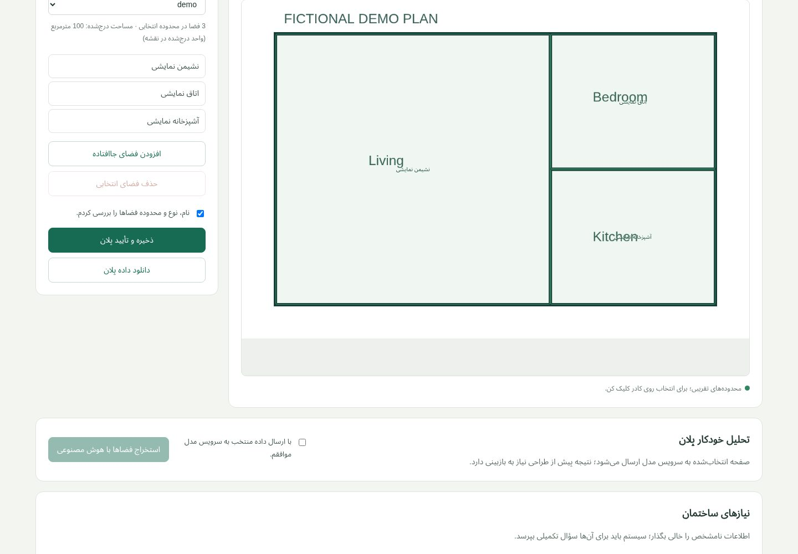
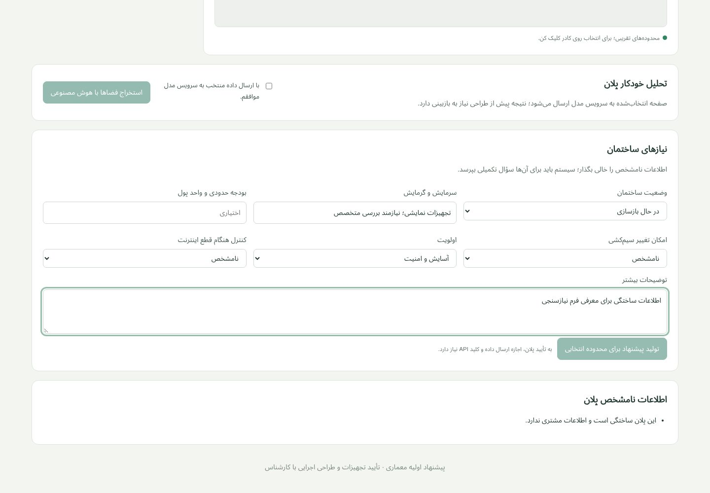
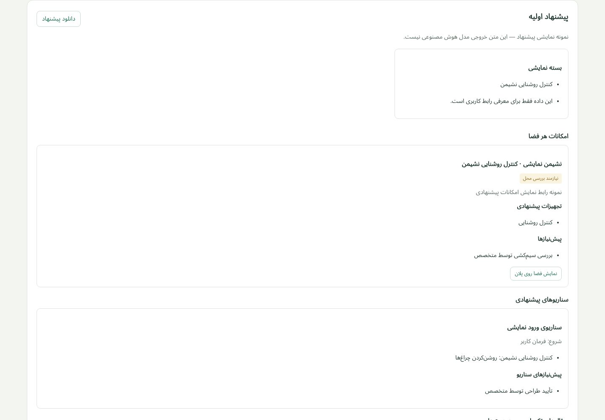

# Smart Home AI — Full Interface Gallery

[← Project](README.md) · [Tab / code coverage](COVERAGE.md) · [All source](SOURCE_INDEX.md)

Open any section to view the actual captured interface. These are demonstrations, not live customer data or production-readiness claims. A screenshot shows a particular viewport/state; some pages continue below the fold.

1. دریافت پلان و بازکردن پروژه

actual UI with a newly drawn fictional plan; config/proposal API fixture explicitly marked as synthetic; no provider request.

[Code 1](source/smart-home-ai/web/app.js) · [Code 2](source/smart-home-ai/web/index.html)

2. بازبینی پلان و فضاهای نمایشی

actual UI with a newly drawn fictional plan; config/proposal API fixture explicitly marked as synthetic; no provider request.

[Code 1](source/smart-home-ai/web/plan-editor.js) · [Code 2](source/smart-home-ai/web/index.html)

3. اصلاح نام و محدوده فضا

actual UI with a newly drawn fictional plan; config/proposal API fixture explicitly marked as synthetic; no provider request.

[Code 1](source/smart-home-ai/web/plan-editor.js) · [Code 2](source/smart-home-ai/web/index.html)

4. تأیید بازبینی پلان

actual UI with a newly drawn fictional plan; config/proposal API fixture explicitly marked as synthetic; no provider request.

[Code 1](source/smart-home-ai/web/plan-editor.js) · [Code 2](source/smart-home-ai/web/index.html)

5. فرم نیازهای ساختمان

actual UI with a newly drawn fictional plan; config/proposal API fixture explicitly marked as synthetic; no provider request.

[Code 1](source/smart-home-ai/web/app.js) · [Code 2](source/smart-home-ai/web/index.html)

6. نمایش پیشنهاد و سناریوها — پاسخ کاملاً ساختگی

actual UI with a newly drawn fictional plan; config/proposal API fixture explicitly marked as synthetic; no provider request.

[Code 1](source/smart-home-ai/web/app.js) · [Code 2](source/smart-home-ai/web/index.html)

