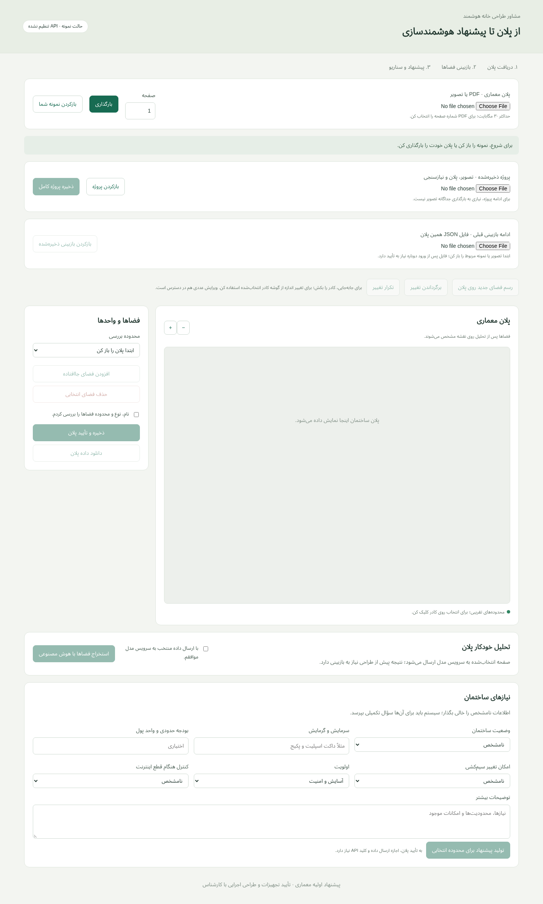

# Smart Home AI — Floor-Plan Review Interface

An early-stage local application for reviewing architectural floor plans and preparing preliminary smart-home suggestions. The real interface supports plan upload, manual geometry edits, review confirmation and building requirements. Model extraction and suggestions require a separately configured provider; CRM/catalog integration and execution design are not implemented.

**Stack:** Python · Pydantic · Pillow · PyMuPDF · JavaScript

[← Profile](../../README.md) · [All project showcases](../README.md)

## Expanded source

This collection contains **4 complete source files**, copied without code changes. It is a reading-oriented source selection, not a standalone runnable application. Imports into omitted modules are intentionally retained.

- Complete browser-side plan editor with selection, drawing and geometry edits.
- UI orchestration for upload, review, project import/export and undo/redo flows.
- Building-requirements form and preliminary proposal presentation.
- Server, provider adapters, prompts, customer plans and model responses are excluded.

### Start reading

- [Plan editor](source/smart-home-ai/web/plan-editor.js)
- [Workflow orchestration](source/smart-home-ai/web/app.js)
- [Interface structure](source/smart-home-ai/web/index.html)
- [Responsive styling](source/smart-home-ai/web/style.css)

Browse the [complete file index](SOURCE_INDEX.md) and [source manifest](SOURCE_MANIFEST.json), which records the exact source revision (or uploaded archive) and SHA-256 of every copied file. No repository-wide license grant is added by this selection; retain existing notices when reviewing the source.

## Interface gallery

Actual initial local interface, without a customer plan. No AI request was made and no generated analysis is shown.

## Publication boundary

This public selection excludes credentials, environment/deployment configuration, databases, backups, uploaded customer files, authentication/session internals, tenant enforcement, payment-provider code and private business orchestration. Code referring to those omitted modules does not include their implementation.

## Verification scope

Copied-file hashes and Python / JavaScript / TypeScript syntax are checked as part of portfolio preparation. Interface captures demonstrate presentation only; they do not establish backend integration, concurrency correctness or production readiness.
